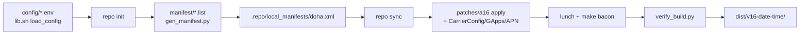

# Repository Guidelines

## Project Overview

`doha A16 buildkit` — reproducible **Android 16 (crDroid 12.13, LineageOS 23.2 / AOSP `android-16.0.0_r4`)** builds for the **Motorola Moto G8 Plus** (`amogus_doha`, SM6125).

This repo contains **no application or ROM source**. It is Bash + Python automation plus 18 patch files that drive `repo`/Soong to fetch, pin, patch, build, verify, collect and publish the ROM for the A13-derived hardware layer on an A16 base. Tracked tree is small (~47 files: 4 Bash, 3 Python, 18 `.patch`, config `*.list`/`*.env`, docs). `VERSION` = `1.0.0`.

Governing philosophy, stated in `README.md` and `docs/ARCHITECTURE.md`: evidence only. Never add zram/thermal/modem/"tweak" changes without a measured difference; never claim a fix that was not verified on the device.

## Architecture & Data Flow

Two entry points over one pipeline; every step is idempotent and resumable via marker files.



1. **Config layering.** `scripts/lib.sh:load_config` sources, in order, `config/build.env` → `config/roms/$ROM.env` → `config/device.env` → `config/pins.env` with `set -a` (all exported). `ROM=...` is the one documented override preserved across loading (saved before, restored after); everything else is clobbered by the files.
2. **Manifest generation.** `manifest/{remotes,core,supporting}.list` are pipe-delimited rows (`path|remote|name|revision|pin|linkfile`); `@PIN_*@` tokens are expanded from `config/pins.env` by `scripts/tools/gen_manifest.py`, which also emits `<remove-project>` for every path in `manifest/paths.txt` so pinned trees always win over the base branch, then writes `work/android/.repo/local_manifests/doha.xml`.
3. **Patching.** Convention over registry: `patches/a16/<project path>.patch` is applied to `$ANDROID_SRC/<project path>`. `apply_patch_to` (`scripts/lib.sh:77-114`) reverse-checks for already-applied, then `git apply --check` → `apply`, then `--3way`; on failure it restores tracked files and **aborts before compiling**. Patches may carry `@NAME@` placeholders (`@SKIN_THROTTLE_MC@`); `render_patch` (`scripts/lib.sh:116-148`) substitutes them from config and dies on an unknown token, so a literal placeholder can never reach the compiler.
4. **Script-driven fixes** in `cmd_patch` after the patches: BSNL CarrierConfig booleans, GApps `libjni_latinimegoogle` module rename (crDroid LatinIME collision), `fix_thermal_placeholders` (repairs a tree patched by an older kit), `fix_apn.py` (missing-only BSNL IMS rows), `fix_build_tree` (drop blocked softap `Android.mk`, duplicate IPA tree, kernel-headers stamp, sepolicy `SEPolicy.mk` symlink). `assert_no_placeholders` then fails fast if any `@TOKEN@` survived.
5. **Build.** `lunch lineage_$(DEVICE)-<aosp_target_release|bp4a>-<variant>` then `make bacon -j$JOBS`, with `TARGET_PRODUCT`/`TARGET_DEVICE` exported early (Kati needs them or `PRODUCT_ENFORCE_PACKAGES_EXIST` explodes) and ccache enabled when present.
6. **Verify/collect.** `verify_build.py` gates the unpacked `out/target/product/amogus_doha`; `collect` copies zip + `boot/dtbo/vbmeta.img` + `SHA256SUMS` + `BUILD_INFO.txt` into `dist/v16-<UTC>/`.

Cloud path (`gcp/doha.sh`) wraps the same script: create VM → rsync kit → `_provision` → `INSTALL_DEPS=1 JOBS=$(nproc) ./scripts/build.sh all` in `tmux` (so SSH drops cannot kill it) → fetch `dist/` → `gh release create` → incremental `rclone sync` to `gdrive:doha-a16/current/`.

**State:** `work/state/<step>.done` markers (`mark`/`is_marked`/`clear_mark`), `work/state/base-manifest.xml`, `work/state/resolved-manifest.xml`, `work/logs/patch.log`. `snapshot` writes a committable `manifests/resolved-<date>.xml`.

## Key Directories

| Path | Purpose |
|---|---|
| `config/` | Build/device/ROM/pin definitions and the host package list. Sourced shell, no arrays. |
| `manifest/` | Hand-maintained repo manifest **inputs**: `core.list` (12 rows), `supporting.list` (29), `remotes.list` (9), `paths.txt` (42 overridden paths). |
| `patches/a16/` | 17 A16 port patches, named by target project path. `patches/carrierconfig/bsnl-volte.patch` is separate. |
| `scripts/` | `build.sh` (single local entry point) + `lib.sh` (helpers). |
| `scripts/tools/` | Standalone stdlib CLIs: `gen_manifest.py`, `fix_apn.py`, `verify_build.py`. |
| `gcp/` | `doha.sh` (VM/build/release/backup/restore) + `README.md` flag reference. |
| `docs/` | Architecture, patch map, BSNL VoLTE, Play Integrity, flashing, verification, future tasks. |
| `debug_dump.sh` | Standalone ADB device diagnostic dump (not executable: run `bash debug_dump.sh`). |
| `work/`, `dist/`, `dist-gcp/`, `gcp/vm.env`, `manifests/`(generated), `device_dump*` | Generated; all gitignored except `manifests/`. Never commit build trees. |

## Development Commands

`scripts/build.sh` is the only local entry point; steps may be run individually and resume from markers.

```bash
./scripts/build.sh dryrun     # validate config/files/scripts/pins/manifest generator, build nothing
./scripts/build.sh deps       # check host packages, fetch the repo launcher into work/bin/
./scripts/build.sh init       # repo init crDroid 16.0 (idempotent)
./scripts/build.sh manifest   # generate .repo/local_manifests/doha.xml
./scripts/build.sh sync       # repo sync, 3 attempts, records resolved-manifest.xml
./scripts/build.sh patch      # apply A16 + CarrierConfig + GApps/APN/tree fixes (fail-closed)
./scripts/build.sh build      # lunch + make bacon -j$JOBS
./scripts/build.sh verify     # post-build image/APK checks
./scripts/build.sh collect    # copy artifacts into dist/v16-<UTC>/
./scripts/build.sh snapshot   # write manifests/resolved-<UTC>.xml
./scripts/build.sh status     # which markers are set + tree size
./scripts/build.sh all        # deps -> init -> manifest -> sync -> patch -> build -> verify -> collect
```

`dryrun` is **not offline**: besides `bash -n` on every `scripts/**/*.sh`, `python3 -m py_compile scripts/tools/*.py`, patch-count and pin-format checks and a synthetic manifest-generator fixture, it runs `git ls-remote` against the base, device, kernel, vendor and GApps remotes.

Equivalent narrow checks when the full dryrun is undesirable:

```bash
find scripts -name '*.sh' -type f -exec bash -n {} + && python3 -m py_compile scripts/tools/*.py
python3 scripts/tools/verify_build.py work/android/out/target/product/amogus_doha
```

Cloud and device:

```bash
./gcp/doha.sh build --no-backup              # create VM + build + fetch dist/ (needs gcloud)
./gcp/doha.sh all --repo OWNER/REPO          # + GitHub release + Drive backup
./gcp/doha.sh status | ssh | stop | start | down
bash debug_dump.sh ./device_dump             # LIGHT=1, GUIDED=1, REDACT=0, BUGREPORT=1, HASH_VENDOR=1
```

Full device test matrix and ADB diagnostics: `docs/VERIFICATION.md`. Flashing/sideloading: `docs/FLASHING.md`.

## Code Conventions & Common Patterns

**Bash** (`scripts/*.sh`, `gcp/doha.sh`)

- `set -euo pipefail` in every script except `debug_dump.sh`, which deliberately uses only `set -u` so one failed probe cannot end a diagnostic run.
- Command handlers are `cmd_<verb>`; helpers are `<verb>_<noun>` or short verbs (`mark`, `die`, `warn`). Config/globals are UPPER_CASE and exported; locals declared with `local`.
- Use `log`/`info`/`warn`/`die` from `scripts/lib.sh` (all to stderr). `die` for unrecoverable; `warn` + continue only when the build stays valid. Four-space indent; quote all expansions; keep `# shellcheck source=`/`disable=` directives intact.
- Prefer editing `config/*.env` over environment variables (see Gotchas).
- Comments explain *why* the Android/build-system needs a step (rate limits, Kati, erofs constraints), not what the line does. Match that style.

**Python** (`scripts/tools/*.py`)

- Standard library only (`pathlib`, `xml.etree.ElementTree`, `zipfile`, `re`, `os`, `sys`) — no third-party packages, no lockfile, no venv.
- `from __future__ import annotations`, snake_case functions, UPPER_CASE constants, type hints, `main() -> int` + `raise SystemExit(main())`.
- Exit codes: `0` success (including non-fatal no-ops), `1` failed gate (`verify_build.py`), `2` bad args/input. Human output uses `[PASS]`/`[FAIL]`/`[WARN]` labels.

**Config & manifest data**

- `config/*.env` are plain sourced shell: no arrays, one setting per line, comments next to non-obvious values.
- Add a ROM by dropping `config/roms/<name>.env` (needs `ROM_NAME`, `ANDROID_VERSION`, `MANIFEST_URL`, `MANIFEST_BRANCH`, `VENDOR_DIR`, `LUNCH_RELEASE`) and selecting it with `ROM=<name>`.
- Add repositories via `manifest/remotes.list` (name → fetch URL) plus `core.list`/`supporting.list` rows and, if the base already provides the path, an entry in `paths.txt`; pins belong in `config/pins.env` as `PIN_*` and are referenced as `@PIN_*@`. Supporting rows must carry a 40-hex SHA; core rows may be tag-pinned (`refs/tags/...`).
- New A16 port patches are picked up automatically from the `patches/a16/<project path>.patch` naming rule — never add a patch list or registry.

**Error handling, state, concurrency**

- Fail closed: patch errors restore the project and stop; the codebase explicitly prefers "no build" over "partially patched tree".
- No DI framework, no async: sequential command dispatch. Parallelism is delegated to `repo sync -j$SYNC_JOBS` and `make -j$JOBS`; long remote builds live in detached `tmux` and are polled for `build.status`.
- Keep `work/` and `dist/` generated-only; all behavior must be reproducible from the repo's config + patches + pins.

## Important Files

| File | Role |
|---|---|
| `scripts/build.sh` | All local steps, patch orchestration, `lunch`/`make bacon`, collect. Read before changing build behavior. |
| `scripts/lib.sh` | `load_config`, path/state resolution, logging, `repo_cmd`, `apply_patch_to`. |
| `scripts/tools/gen_manifest.py` | Base manifest + lists → `doha.xml` (removals, pins, linkfiles). |
| `scripts/tools/fix_apn.py` | Missing-only BSNL IMS row injection into the synced `vendor/apn`. |
| `scripts/tools/verify_build.py` | Post-build gate; fatal = missing GApps, Play Store, `libqsap_sdk.so`. |
| `gcp/doha.sh` | gcloud VM lifecycle, remote build, `gh` release, rclone backup/restore. |
| `config/build.env` | Variant, jobs, ccache, GApps, signing, paths. |
| `config/device.env` | Device identity, kernel slot/config, partition facts ("do not 'fix' these"). |
| `config/pins.env` | Every port-critical and patched project commit. |
| `config/roms/crdroid-16.env` | crDroid manifest URL/branch, `LUNCH_RELEASE=bp4a`, `VENDOR_DIR`. |
| `patches/README.md`, `docs/PATCHES.md` | Patch provenance and the failure each patch prevents. |
| `docs/VERIFICATION.md`, `docs/FUTURE_TASKS.md` | QA gates, device matrix, open constraints. |

## Runtime/Tooling Preferences

- **Bash 4+** (`declare -A` in `gcp/doha.sh`) and **Python 3.9+** ([INFERENCE] floor set by `ET.indent`), standard library only — no pip installs. No Node/Bun, no `package.json`, no Makefile/justfile/Gradle/pyproject, no lockfile of any kind.
- Ubuntu 22.04/24.04/26.04 host (native or WSL2 on the Linux filesystem). Required host packages live in `config/packages.list` (33 entries, installed via `apt`); `repo`, `git-lfs` and `ccache` matter most.
- Resources: 400 GB free minimum (250 GB checkout + 150 GB `out/`), 32 GB RAM preferred (16 GB with swap; Soong peaks ~20 GB), 8+ threads. `deps` warns below 250 GB.
- `gcloud`/`gh`/`rclone`/`tmux` are needed only for the GCP path (`gcp/README.md`); `adb`/`fastboot` only for device work.
- GCP VM defaults are set in `gcp/doha.sh:27-48` (`ubuntu-2404-lts-amd64`, fastest 16 vCPU shape first — `c2d-standard-16`, then `c2d-standard-8`, `t2d-standard-16`, `n2`, `n2d`, `e2` — `DISK_SIZE=500GB`, `pd-standard`, `VM_NAME=doha-a16-builder`) and persisted to ignored `gcp/vm.env`. The `e2` family is the slowest per core; it is last in the preference list.
- `debug_dump.sh` is mode `664`: invoke it as `bash debug_dump.sh`, never `./debug_dump.sh`. JDK/NDK are not pinned here; the Android JDK comes from the fetched tree.

## Testing & QA

There is **no test framework, no test files, no CI, and no coverage tooling** in this repo — no `.github/workflows/`, no pytest/unittest, no lint/format/typecheck config. Verification is scripted post-build inspection plus a manual device matrix. Do not claim a behavior was tested unless it ran through one of these gates.

| Gate | Command | Scope |
|---|---|---|
| Static dryrun | `./scripts/build.sh dryrun` | Config presence, `bash -n`, `py_compile`, ≥17 A16 patches + CarrierConfig patch, pin formats, manifest generator fixture, remote reachability. Exits non-zero on failure. |
| Patch application | `./scripts/build.sh patch` | Reverse-check → `--check` → 3-way; restores and stops on failure (`work/logs/patch.log`). |
| Post-build | `./scripts/build.sh verify` | `verify_build.py` on `out/target/product/amogus_doha`: fatal for missing `GmsCore.apk`, `Phonesky.apk`, `libqsap_sdk.so`; `[WARN]` for test-keys/`ro.debuggable` and absent perf-tuning strip. |
| Artifact integrity | `sha256sum -c SHA256SUMS` inside `dist/v16-*/` | Collected zip/images. |
| Device acceptance | `docs/VERIFICATION.md` T1–T12 | Manual: 72 h, hotspot/tethering, BSNL SIM1 calls, touch panels, heat, Play Integrity BASIC. A build is not "stable" before this. |
| Diagnostics | `bash debug_dump.sh` | ADB dump, optional `GUIDED=1` feature tests, redacted archive for sharing; compare against a baseline dump. |

Useful conventions when touching QA code: keep `PASS`/`FAIL`/`WARN` counters and the "fatal only for port-critical pieces" split in `verify_build.py`; keep `fix_apn.py` non-fatal (the CarrierConfig fix is independent); keep `dryrun` cheap and non-building.

Known doc/code discrepancies — trust the code:

- `docs/VERIFICATION.md` marks the CarrierConfig BSNL check "no (warn)", but `verify_build.py` calls `bad()` (fatal) when `CarrierConfig.apk` exists and lacks `carrier_volte_available_bool`; a missing APK is only a warning.
- `README.md`/`gcp/README.md` advertise a 700 GB VM disk and `pd-balanced`; `gcp/doha.sh` defaults to `DISK_SIZE=500GB` with `pd-standard`. Its usage text also disagrees with the 500 GB code default.
- `README.md` says 28 supporting repositories; `manifest/supporting.list` has 29 rows.
- `debug_dump.sh` references `analyze_dump.sh`, `compare_dumps.sh` and `COVERAGE.md`, none of which exist.

## Gotchas for Assistants

- **Never delete or skip a patch to make a build pass.** `patches/README.md` and `docs/PATCHES.md` are explicit: rebase the patch against the synced file and keep the semantic change.
- **Never hand-edit `work/android/**`.** It is regenerated by `sync`/`patch`; upstream-side fixes belong in `patches/a16/<project path>.patch` with original headers/credits preserved.
- **Environment overrides: only a few survive `load_config`.** `ROM`, `JOBS`, `SYNC_JOBS` and `INSTALL_DEPS` are captured before `config/build.env` is sourced and restored afterwards (`scripts/lib.sh:13-28`); `DEVICE`, `SIGNING`, `BUILD_VARIANT`, `ANDROID_SRC`, `DIST_DIR` and the GApps settings are still clobbered by the file. Edit `config/*.env` for those.
- **`manifest/` (inputs, hand-edited) vs `manifests/` (generated snapshots).** Mixing them up breaks reproducibility; commit `manifests/resolved-*.xml` when a build must be reproducible later.
- **`gcp/vm.env` fills in only what you did not pass on the command line** — explicit `--zone`/`--machine-type`/`--disk-size` flags now win over the remembered VM (flag vars are captured in `gcp/doha.sh:103-133`). `--yes` is parsed but unused. `rclone-setup` always writes a remote named `gdrive` regardless of `--remote`. The created firewall rule `doha-allow-ssh` opens tcp/22 to `SSH_SOURCE_RANGE`, default `0.0.0.0/0` — narrow it before leaving a VM up.
- **A stopped VM still bills for its disk.** `cmd_build`/`cmd_all` call `destroy_vm` after the build (success *or* failure) and delete the boot disk; pass `--keep-vm` to keep it (it keeps billing). Delete the VM instead of stopping it when the build is done.
- **Never ship or test with root ADB enabled.** Run `adb unroot` and reboot before Play Integrity or banking tests; `service.adb.root=1` must not ship (`docs/FUTURE_TASKS.md`).
- **Integrity claims are capped.** BASIC is the target; DEVICE may need a user-side PlayIntegrityFix/TrickyStore module; STRONG is impossible on an unlocked bootloader. No fingerprint spoofing in the ROM.
- **Device constraints are structural:** A/B, non-dynamic partitions, read-only erofs `system`/`vendor`, recovery inside `boot.img`. GApps must stay baked in (`BUNDLE_GAPPS=true`); never flash a separate GApps zip; flash `boot`/`dtbo`/`vbmeta` only from the same build; the ROM does not change modem firmware.
- **BSNL is CSFB-first unless proven otherwise.** The CarrierConfig carrier-id-1549 asset filename is load-bearing; APN injection must stay missing-only, and `persist.dbg.volte_avail_ovr` is deliberately not scrubbed.
- Keep `work/`, `dist/`, `dist-gcp/`, `gcp/vm.env` and `device_dump*` out of commits.
