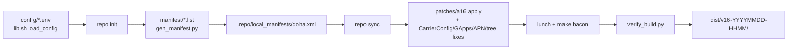

# Repository Guidelines

## Project Overview

`doha A16 buildkit` (VERSION `1.0.0`) — reproducible **Android 16** builds for the
**Motorola Moto G8 Plus** (`amogus_doha`, SM6125): crDroid 12.13 / LineageOS 23.2
on AOSP `android-16.0.0_r4`.

This repo contains **no application or ROM source**. It is Bash + Python automation
plus 18 patch files that drive `repo`/Soong to fetch pinned trees, apply the A16
port, build, verify, collect and publish a ROM. The device layer is the stable
A13-era community port; the Android 16 platform assumptions are fixed by the patch
set in `patches/`.

Governing rule from `README.md`/`docs/ARCHITECTURE.md`: **evidence only**. Never add
zram/thermal/modem/"tweak" changes without a measured difference, and never claim a
fix that was not verified on the device.

Two entry points, one pipeline:

- `scripts/build.sh` — local, resumable, marker-driven steps.
- `gcp/doha.sh` — GCP VM lifecycle wrapping the same script, plus GitHub release and
  rclone backup/restore.

## Architecture & Data Flow



1. **Config layering.** `scripts/lib.sh:load_config` sources, in order,
   `config/build.env` → `config/roms/$ROM.env` → `config/device.env` →
   `config/pins.env`, all under `set -a` (everything exported). Only `ROM`, `JOBS`,
   `SYNC_JOBS` and `INSTALL_DEPS` are captured before loading and restored after; all
   other env overrides are clobbered by the files. Empty values are then defaulted:
   `ANDROID_SRC=<repo>/work/android`, `DIST_DIR=<repo>/dist`,
   `JOBS/SYNC_JOBS=nproc`, `BUILD_VARIANT=userdebug`, `BUNDLE_GAPPS=true`,
   `GAPPS_BRANCH=baklava`, `SIGNING=test`, `CCACHE_DIR=work/ccache`,
   `CCACHE_MAXSIZE=50G`. Paths `WORK`/`STATE`/`LOGS`/`PATCHES`/`MANIFEST_DIR`/`OUT`
   are derived here.
2. **Manifest generation.** `manifest/{remotes,core,supporting}.list` are
   pipe-delimited rows (`path|remote|name|revision|pin|linkfile`), plus
   `manifest/paths.txt`. `scripts/tools/gen_manifest.py` expands `@PIN_*@` from the
   exported `config/pins.env`, emits `<remove-project>` for every base project whose
   path is in `paths.txt` (so pinned trees win over the base branch), then writes
   `.repo/local_manifests/doha.xml`.
3. **Patching.** Convention over registry: `patches/a16/<project path>.patch` is
   applied to `$ANDROID_SRC/<project path>`. `apply_patch_to`
   (`scripts/lib.sh:77-117`) reverse-checks for already-applied, runs
   `git apply --check`, applies, then retries with `--3way`; on failure it restores
   tracked files and aborts before compiling. Patches may carry `@NAME@`
   placeholders; `render_patch` substitutes them from config (`@SKIN_THROTTLE_MC@` ←
   `SKIN_THROTTLE_C * 1000`) and dies on an unknown token.
   `device/qcom/sepolicy_vndr/legacy-um.patch` is remapped to
   `device/qcom/sepolicy_vndr` unless the nested `legacy-um/.git` checkout exists.
4. **Script-driven fixes** in `cmd_patch`: `patch_carrierconfig` (idempotent
   `--3way`, then XML insertion fallback), `patch_gapps` (rename
   `libjni_latinimegoogle` to `_gapps` in both ABI `Android.bp` and drop it from the
   `*-vendor.mk` lists), `fix_thermal_placeholders` (repair a tree patched by an
   older kit), `fix_apn.py` (missing-only BSNL IMS rows; non-fatal), then
   `fix_build_tree`: delete `system/qcom/softap/sdk/Android.mk`, delete the duplicate
   `data-ipa-cfg-mgr-legacy-um` tree, truncate `device/motorola/amogus_doha/kernel-headers`,
   and symlink `device/qcom/sepolicy_vndr/SEPolicy.mk` to
   `hardware/qcom-caf/common/os_pickup_sepolicy_vndr.mk`. `assert_no_placeholders`
   then fails the step if any `@TOKEN@` survived.
5. **Build.** Check `$VENDOR_DIR`, the product `.mk` and `device.mk`; if
   `SIGNING=release`, require `vendor/lineage-priv/keys/keys.mk`. Export
   `TARGET_PRODUCT=lineage_$DEVICE`, `TARGET_DEVICE`, `ALLOW_MISSING_DEPENDENCIES=true`
   (Kati needs them or `PRODUCT_ENFORCE_PACKAGES_EXIST` explodes), enable ccache when
   present, source `build/envsetup.sh`, apply `vendor/lineage/vars/aosp_target_release`
   when present, `lunch lineage_$DEVICE-$LUNCH_RELEASE-$BUILD_VARIANT`, verify the
   resolved product/variant, then `make bacon -j$JOBS`.
6. **Verify/collect.** `verify_build.py` gates the unpacked
   `out/target/product/amogus_doha`; `collect` copies the zip + `boot/dtbo/vbmeta.img`
   + `SHA256SUMS` + `BUILD_INFO.txt` into `dist/v16-YYYYMMDD-HHMM/` (UTC).

**State:** `work/state/<step>.done` markers (`mark`/`is_marked`/`clear_mark`),
`work/state/base-manifest.xml`, `work/state/resolved-manifest.xml`,
`work/logs/patch.log`. `snapshot` writes a committable
`manifests/resolved-<UTC>.xml` via `repo manifest -r`.

**Cloud path:** `cmd_build` = create/lookup VM → tar+scp the kit (excludes `work/`,
`dist/`, `.git`, `gcp/vm.env`, `__pycache__`) → `tmux` session `doha` running
`_chain` (provision → rclone check → `build.sh all`), which writes `chain.status` →
the wrapper polls with short SSH calls, treating a dropped channel as transient →
fetch `dist/` into `dist-gcp/` → optional incremental rclone copy → `destroy_vm`.
`cmd_all` does the same, then `gh release` (tag `a16-<stamp>`) and backup before the
destroy, exiting non-zero if either fails. A failed chain fetches logs and destroys
the VM; the VM is never destroyed while the tmux session is still running. On the VM
itself (`on_gce`), the same chain runs locally.

## Key Directories

| Path | Purpose |
|---|---|
| `config/` | Sourced shell definitions: `build.env`, `device.env`, `pins.env`, `roms/*.env`, host `packages.list`. No arrays. |
| `manifest/` | Hand-maintained manifest **inputs**: `core.list` (12 rows), `supporting.list` (29), `remotes.list` (9), `paths.txt` (42 overridden paths). |
| `patches/a16/` | 17 A16 port patches named by target project path. |
| `patches/carrierconfig/` | `bsnl-volte.patch`, a one-file patch against AOSP CarrierConfig r4. |
| `scripts/` | `build.sh` (only local entry point) + `lib.sh` (config, state, logging, patch application). |
| `scripts/tools/` | Standalone stdlib CLIs: `gen_manifest.py`, `fix_apn.py`, `verify_build.py`. |
| `gcp/` | `doha.sh` (VM/build/release/backup/restore) + `README.md` flag reference. |
| `docs/` | Architecture, patch map, BSNL VoLTE, Play Integrity, flashing, verification, future tasks. |
| `debug_dump.sh` | Standalone ADB diagnostic dump; mode `664`, so run `bash debug_dump.sh`. |
| `work/`, `dist/`, `dist-gcp/`, `gcp/vm.env`, `device_dump*` | Generated, gitignored. Never commit build trees. `manifests/` is generated but meant to be committed. |

## Development Commands

Every step is idempotent and resumable from markers.

```bash
./scripts/build.sh dryrun     # validate config/files/scripts/pins/manifest generator, build nothing
./scripts/build.sh deps       # host packages + repo launcher into work/bin/
./scripts/build.sh init       # repo init crDroid 16.0 (idempotent)
./scripts/build.sh manifest   # generate .repo/local_manifests/doha.xml
./scripts/build.sh sync       # repo sync, 3 attempts/30 s backoff, records resolved manifest
./scripts/build.sh patch      # apply A16 + CarrierConfig + GApps/APN/tree fixes (fail-closed)
./scripts/build.sh build      # lunch + make bacon -j$JOBS
./scripts/build.sh verify     # post-build image/APK gate
./scripts/build.sh collect    # copy artifacts into dist/v16-YYYYMMDD-HHMM/
./scripts/build.sh snapshot   # write manifests/resolved-<UTC>.xml
./scripts/build.sh status     # markers, tree size, recent dist entries
./scripts/build.sh all        # deps -> init -> manifest -> sync -> patch -> build -> verify -> collect
```

`dryrun` is **not offline**. It checks config presence, `bash -n` on every
`scripts/**/*.sh`, `py_compile` on every tool, ≥17 A16 patches plus the CarrierConfig
patch, pin formats (supporting rows need 40-hex; core rows need a pin or
`refs/tags/`), runs `gen_manifest.py` against a synthetic base manifest and asserts
the removals/project output, then runs `git ls-remote` against the base, device,
kernel, vendor and GApps remotes.

Narrow equivalents:

```bash
find scripts -name '*.sh' -type f -exec bash -n {} + && python3 -m py_compile scripts/tools/*.py
python3 scripts/tools/verify_build.py work/android/out/target/product/amogus_doha
```

Cloud/device:

```bash
./gcp/doha.sh build --no-backup          # create VM + build + fetch dist/ (needs gcloud)
./gcp/doha.sh all --repo OWNER/REPO      # + GitHub release + Drive backup
./gcp/doha.sh status | ssh | stop | start | down | snapshots
bash debug_dump.sh ./device_dump         # LIGHT=1 GUIDED=1 REDACT=0 BUGREPORT=1 HASH_VENDOR=1
```

## Code Conventions & Common Patterns

**Bash** (`scripts/*.sh`, `gcp/doha.sh`)

- `set -euo pipefail` everywhere except `debug_dump.sh`, which deliberately uses only
  `set -u` so one failed probe cannot end a diagnostic run.
- Handlers are `cmd_<verb>`; helpers are `<verb>_<noun>` or short verbs
  (`mark`, `die`, `warn`, `apply_patch_to`). Config/globals are UPPER_CASE and
  exported; locals use `local`. Four-space indent; quote all expansions; keep
  `# shellcheck source=`/`disable=` directives.
- Log through `log`/`info`/`warn`/`die` from `lib.sh` (stderr). `die` for
  unrecoverable; `warn` + continue only when the build stays valid.
- Fail closed: a patch error restores the project and stops. Never skip a patch to
  make a build pass.
- Comments explain *why* Android/build-system needs a step (Kati, erofs, rate
  limits), not what the line does.

**Python** (`scripts/tools/*.py`)

- Standard library only; no third-party packages, venv or lockfile.
- `from __future__ import annotations`, snake_case functions, UPPER_CASE constants,
  type hints, `main() -> int` + `raise SystemExit(main())`.
- Exit codes: `0` success (including non-fatal no-ops), `1` failed gate, `2` bad
  args/input. Output labels `[PASS]`/`[FAIL]`/`[WARN]`.

**Config & manifest data**

- `config/*.env` are plain sourced shell: one setting per line, no arrays; comments
  next to non-obvious values. Add a ROM by dropping `config/roms/<name>.env` with
  `ROM_NAME` (display only), `ANDROID_VERSION`, `MANIFEST_URL`, `MANIFEST_BRANCH`,
  `VENDOR_DIR`, `LUNCH_RELEASE`; `PRODUCT_PREFIX` is carried but unused by the scripts.
- Add repositories via `manifest/remotes.list` + a `core.list`/`supporting.list` row,
  plus a `paths.txt` entry if the base already provides the path. Pins live in
  `config/pins.env` as `PIN_*` and are referenced as `@PIN_*@`. Supporting rows must
  carry a 40-hex SHA; core rows may be tag-pinned (`refs/tags/...`).
- New A16 patches are discovered from the `patches/a16/<project path>.patch` naming
  rule — never add a patch list or registry. Keep upstream headers/credits; never
  hand-edit `work/android/**`.

## Important Files

| File | Role |
|---|---|
| `scripts/build.sh` | All local steps, patch orchestration, `lunch`/`make bacon`, collect. Read before changing build behavior. |
| `scripts/lib.sh` | `load_config`, path/state resolution, logging, `repo_cmd`, `apply_patch_to`, `render_patch`, placeholder guard. |
| `scripts/tools/gen_manifest.py` | Base manifest + lists → `doha.xml` (removals, pins, linkfiles). |
| `scripts/tools/fix_apn.py` | Missing-only BSNL IMS row injection into the synced `vendor/apn`. |
| `scripts/tools/verify_build.py` | Post-build gate; fatal = missing GApps, Play Store, `libqsap_sdk.so`, or CarrierConfig present without the BSNL key. |
| `gcp/doha.sh` | gcloud VM lifecycle, remote build, `gh` release, rclone backup/restore. |
| `config/build.env` | Variant, jobs, ccache, GApps, signing, paths. |
| `config/device.env` | Device identity, kernel slot/config, partition facts ("do not fix these"). |
| `config/pins.env` | 15 pinned commits: hardware layer, GApps, every patched project. |
| `config/roms/crdroid-16.env` | crDroid manifest URL/branch, `LUNCH_RELEASE=bp4a`, `VENDOR_DIR=vendor/lineage`. |
| `patches/README.md`, `docs/PATCHES.md` | Patch provenance and the failure each patch prevents. |
| `docs/VERIFICATION.md`, `docs/FUTURE_TASKS.md` | QA gates, device matrix, open constraints. |

## Runtime/Tooling Preferences

- **Bash 4+** (`declare -A` in `gcp/doha.sh`) and **Python 3.9+** (`ET.indent`), stdlib
  only. No Node/Bun, no `package.json`, no Makefile/justfile/pyproject, no lockfile.
- Ubuntu 22.04/24.04/26.04 host (native or WSL2 on the Linux filesystem). Host
  packages in `config/packages.list` (33 entries, `apt`); `repo`, `git-lfs` and
  `ccache` matter most.
- 400 GB free minimum (250 GB checkout + 150 GB `out/`), 32 GB RAM preferred (16 GB
  with swap; Soong peaks ~20 GB), 8+ threads. `deps` warns below 250 GB.
- `gcloud`/`gh`/`rclone`/`tmux` are only needed for the GCP path; `adb`/`fastboot` only
  for device work.
- GCP defaults in `gcp/doha.sh:27-44`: `ubuntu-2404-lts-amd64`, shapes tried in order
  `n2-custom-12-65536`, `c2d-standard-8`, `e2-custom-8-32768` (`t2a` is ARM64;
  `c2d`/`t2d`/`c3` custom types 404 in this project, only `n1`/`n2`/`e2` custom
  types resolve); `DISK_SIZE=600GB`, `DISK_TYPE=pd-standard` (`pd-balanced` bills
  against `SSD_TOTAL_GB=250`, so 600 GB forces standard); cheapest regions first;
  `VM_NAME=doha-a16-builder`;
  `SSH_SOURCE_RANGE=0.0.0.0/0`; `GH_REPO=ishwar-chandra/amogus_doha_custom_rom`;
  `RCLONE_REMOTE=gdrive`, `RCLONE_DIR=doha-a16`. Persisted to ignored `gcp/vm.env`;
  explicit flags win over remembered values.
- Project quota caps this kit hard: `CPUS_ALL_REGIONS=12` (12 vCPU total, any family),
  `SSD_TOTAL_GB=250`, `DISKS_TOTAL_GB=2048`, `PREEMPTIBLE_CPUS=0` (so `--spot` is
  rejected), `GPUS_ALL_REGIONS=0`.
- `_provision` pins the fastest IPv4 backend of the Ubuntu archive in `/etc/hosts` and
  writes `Acquire::ForceIPv4 "true";` (`/etc/apt/apt.conf.d/99-doha`) before
  `apt-get update`; the archive hostname round-robins and one slow backend can stall
  provisioning for an hour.

## Testing & QA

There is **no test framework, no test files, no CI, no coverage tooling** — no
`.github/workflows/`, no pytest/unittest, no lint/format/typecheck config. Do not
claim a behavior was tested unless it ran through one of these gates.

| Gate | Command | Scope |
|---|---|---|
| Static dryrun | `./scripts/build.sh dryrun` | Config presence, `bash -n`, `py_compile`, patch count, pin formats, manifest-generator fixture, remote reachability. Not offline. |
| Patch application | `./scripts/build.sh patch` | Reverse-check → `--check` → apply → `--3way`; restores and stops on failure (`work/logs/patch.log`). |
| Post-build | `./scripts/build.sh verify` | Fatal: missing `GmsCore.apk`, `Phonesky.apk`, `libqsap_sdk.so`; CarrierConfig present but lacking `carrier_volte_available_bool`. Warn: missing CarrierConfig/APN rows, test keys, `ro.debuggable=1`, `init.amogus_perf.rc` present. |
| Artifact integrity | `sha256sum -c SHA256SUMS` in `dist/v16-*/` | Collected zip/images. |
| Device acceptance | `docs/VERIFICATION.md` T1–T12 | Manual, 72 h before calling a build stable: hotspot/USB tethering, BSNL SIM1 calls, touch panels, heat, Play Integrity BASIC, dirty-flash. |
| Diagnostics | `bash debug_dump.sh` | ADB dump; redacted archive by default (`REDACT=0` keeps raw); knobs `LIGHT`, `GUIDED`, `GUIDED_ONLY`, `BUGREPORT`, `HASH_VENDOR`, `REPRO_SIM1`, `TMO`, `ALL_SERVICES`, `ANALYZE`. |

When touching QA code, keep the PASS/FAIL/WARN counters and the "fatal only for
port-critical pieces" split in `verify_build.py`, keep `fix_apn.py` non-fatal
(CarrierConfig is independent), and keep `dryrun` cheap and non-building.

**Hard rules**

- Never delete or skip a patch to make a build pass; rebase it against the synced file
  and keep the semantic change.
- Never hand-edit `work/android/**`; upstream-side fixes go in
  `patches/a16/<project path>.patch`.
- Never ship or test with root ADB enabled: `adb unroot` + reboot before Play
  Integrity or banking tests; `service.adb.root=1` must not ship.
- Integrity claims are capped: BASIC is the target; DEVICE may need a user-side
  PlayIntegrityFix/TrickyStore module; STRONG is impossible on an unlocked bootloader.
  No fingerprint spoofing in the ROM.
- Device constraints are structural: A/B, non-dynamic partitions, read-only erofs
  `system`/`vendor`, recovery inside `boot.img`. GApps must stay baked in
  (`BUNDLE_GAPPS=true`); never flash a separate GApps zip; flash
  `boot`/`dtbo`/`vbmeta` only from the same build; the ROM does not change modem
  firmware.
- BSNL is CSFB-first unless proven otherwise. The carrier-id-1549 asset filename is
  load-bearing; APN injection stays missing-only; `persist.dbg.volte_avail_ovr` is
  deliberately not scrubbed.
- Keep `work/`, `dist/`, `dist-gcp/`, `gcp/vm.env` and `device_dump*` out of commits.
- `manifest/` holds hand-edited inputs; `manifests/` holds generated snapshots. Commit
  a snapshot when a build must be reproducible later.

**Device evidence baseline (A13)**

Source: `device_dump/` from crDroid 9.20 (Android 13, SPL 2025-01-07); full checklist
in `docs/FUTURE_TASKS.md`. These are measurements to preserve or re-test, not
assumptions:

- BSNL is CSFB-first: A13 showed `isVopsSupported=false`, `mcfg_version=null` for
  BSNL, while Jio had an IMS APN and `mcfg_version=RJIO_IND`. Test 3G/2G-only calls
  before enabling VoLTE/IMS; `persist.dbg.volte_avail_ovr=1` is not proof of VoLTE.
- GNSS: A13 `lshal` never saw `vendor.qti.gnss@4.0`; `com.qualcomm.location.XT` ANR'd
  roughly every 20 s in `LocIDLClientBase.getIDLServiceVersion`. Re-check with
  `lshal | grep -i gnss` and fix registration or drop `xtra_t_app`.
- USB tethering: A13 logged `mUsbTetheringFunction=RNDIS` but repeated `rndis:false`
  broadcasts with no tethered interface; the `close_range()` patch does not prove
  tethering works.
- Baseline posture: `user`, `release-keys`, locked, verified-boot green,
  `ro.debuggable=0`. Release requires `BUILD_VARIANT=user` + `SIGNING=release`; never
  ship root ADB, and do not go SELinux-permissive to silence Play Integrity probes.
- Keep touch (`fts_ts_doha`, FocalTech/Nova), thermal behaviour (37–40 °C, no
  throttling at capture) and SPL ≥ 2025-01-07 unless a new measurement says otherwise.

**Known doc/code discrepancies & gotchas — trust the code**

- `README.md` and `gcp/README.md` advertise a 700 GB disk; the code default is
  `DISK_SIZE=600GB`, `pd-standard`.
- `README.md` says 12 vCPU / 48 GB, `gcp/README.md` says 16 vCPU / 64 GB and suggests
  `c2d-standard-16` / `e2-standard-12`; the quota allows 12 vCPU, no predefined
  12-vCPU shape exists, and only `n2` exposes 12-vCPU custom types here, so the code
  uses `n2-custom-12-65536` with `c2d-standard-8` / `e2-custom-8-32768` fallbacks.
- `README.md` says 28 supporting repositories; `manifest/supporting.list` has 29 rows.
- `README.md` says `dryrun` warns below 250 GB free and 16 GB RAM; the disk warning is
  in `cmd_deps`, and there is no RAM check.
- `scripts/build.sh` usage lists `DEVICE`, `ANDROID_SRC`, `DIST_DIR`, `BUILD_VARIANT`,
  `BUNDLE_GAPPS`, `GAPPS_BRANCH`, `SIGNING` as environment overrides; `load_config`
  only preserves `ROM`, `JOBS`, `SYNC_JOBS`, `INSTALL_DEPS`.
- `docs/VERIFICATION.md` marks the CarrierConfig BSNL check "no (warn)", but
  `verify_build.py` calls `bad()` (fatal) when the APK exists and lacks the key; a
  missing APK is only a warning.
- `docs/PATCHES.md` says "applied by `50-patch`"; the step is `patch`.
- `debug_dump.sh` references `analyze_dump.sh`, `compare_dumps.sh` and `COVERAGE.md`,
  none of which exist; its header shows `./debug_dump.sh` although the file is mode
  `664`.
- GCP runtime: `--yes` is parsed but unused; `rclone-setup` always creates a remote
  named `gdrive` regardless of `--remote`; `--local` switches to on-host
  backup/restore, it does not disable backup.
- A failed build still fetches `dist/` + `build.log` and destroys the VM. `--keep-vm`
  keeps it, and a stopped VM keeps billing for its disk — delete it when done.
- The `doha-allow-ssh` rule opens tcp/22 to `SSH_SOURCE_RANGE` (default `0.0.0.0/0`);
  narrow it before leaving a VM up.
