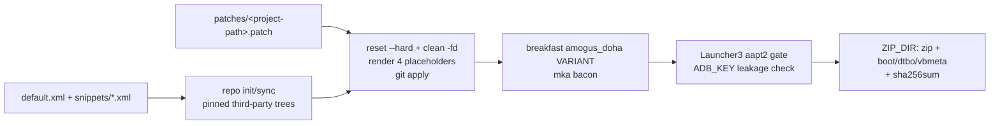

# Repository Guidelines

## Project Overview

Build recipe for an unofficial **crDroid 13.1 (Android 17)** ROM for the Motorola Moto G8 Plus
(`doha`, in-tree device `amogus_doha`; Snapdragon 665/trinket, 4.14 kernel, LineageOS 24.0 base).
This repository is **not an Android source tree**: there is no `src/`, no app code, and no test
suite to edit. It pins third-party trees through a `repo` manifest, adapts them with **28
per-project patches**, and builds, releases, flashes, and verifies them with `build.sh` and
`tools/`.

The patch set is the product. Everything else is plumbing around it.

- Manifest branch `17.0` means crDroid **13.1**, not Android 13. Artifacts still read
  `crDroidAndroid-17.0-<date>-amogus_doha-v13.1...zip`.
- Work normally lands on `performance-tuning` and is merged into `crdroid-android-17` before
  building. `main` (LineageOS 23.2 / Android 16) and `lineage-24.0` (LineageOS 24.0 / Android 17)
  are separate lines: never merge crDroid work back into them.
- `README.md` is the authoritative design record and the per-fix rationale; an undocumented patch
  is a maintenance hazard.

## Architecture & Data Flow



`default.xml` is crDroid's manifest plus our remotes and three includes, last-wins:
`snippets/crdroid.xml` (64 crDroid-fork projects), `snippets/lineage.xml` (176 LineageOS
projects), `snippets/doha.xml` (ours: **27** `local::doha` projects, all SHA-pinned). `doha.xml`
starts with two `<remove-project>` entries: AOSP `platform/external/fastrpc` (AOSPA copy wins) and
LineageOS's IPACM at `vendor/qcom/opensource/data-ipa-cfg-mgr-legacy-um` (moto-common's
`data-ipa-cfg-mgr-legacy` wins; removed by name **and** path so other devices' same-named trees
survive). Only `doha.xml` is locally owned; `crdroid.xml`/`lineage.xml` are verbatim rebase
baselines — re-copy them, do not edit.

Patch application (`build.sh`):

1. The project list is derived from filenames: `find patches -name '*.patch'` → `<project path>`.
   A patch's diff paths are relative to that manifest project's root.
2. For each project: render placeholders, compare the rendered patch blob and the worktree tree
   against `$SRC/.repo/doha-patches` (format `<project> <patch blob> <tree>`). Unchanged → skip and
   preserve mtimes. Changed → `git reset --hard && git clean -fd`, then
   `git apply --whitespace=nowarn`.
3. Patches deleted or renamed since the last run are reverted. Ordering is irrelevant because there
   is exactly one patch per project and each is applied with `-C "$proj"`.
4. An empty **file** `device/motorola/amogus_doha/kernel-headers` is created to block AOSP's
   header-directory autodetect; real headers come from `PRODUCT_VENDOR_KERNEL_HEADERS`
   (`patches/device/motorola/targets.patch`).

Build-affecting settings render into patches through exactly four tokens; the stamp hashes the
rendered text, so changing a setting re-applies the affected patches and rebuilds those projects:

|Token|Value|Patch(es)|
|---|---|---|
|`@SKIN_THROTTLE_MC@`|`SKIN_THROTTLE_C * 1000`|`vendor/qcom/opensource/thermal.patch`|
|`@DEBLOAT@`|`0` or `1`|`device/motorola/targets.patch` (consumed as `DEBLOAT_BUILD` by `vendor/lineage.patch`)|
|`@READAHEAD_KB@`|`READAHEAD_KB`|`device/qcom/common.patch`, `device/motorola/amogus.patch`|
|`@UPDATER_CHANNEL@`|`standard` or `debloat`|`packages/apps/Updater.patch`|

Subsystems:

|Area|Patches|Responsibility|
|---|---|---|
|Device, storage, policy|`device/motorola/{amogus,amogus_doha,common,targets}`, `device/lineage/sepolicy`, `device/qcom/common`, `device/qcom/sepolicy_vndr/legacy-um`, `system/sepolicy` (8)|boot cmdline, ext4 system + metadata, fstab/zram/discard, module load list, sepolicy dedupe, runtime knobs, kernel headers|
|Android 17 on 4.14|`kernel/motorola/msm-4.14`, `packages/modules/Connectivity`, `hardware/interfaces`, `system/zygote`, `frameworks/base` (5)|initramfs boot, BPF gates/ring buffers, capability bounds, AppOp registration|
|Vendor, HIDL, blobs|`vendor/motorola/*`, `vendor/qcom/*`, `frameworks/hardware/interfaces`, `system/tools/hidl`, `hardware/{motorola,nxp/nfc}` (11)|RIL libqsap, camera blob, OEMCrypto, QCC removal, FM/Wi-Fi services, camcorder profile, thermal HAL, display service, NFC retry|
|Product, OTA, debloat|`vendor/lineage`, `packages/apps/{Updater,crDroidSettings}` (3)|package gating, per-channel OTA feed, keybox prompt, dead-preference pruning|
|Launcher|`packages/apps/Launcher3` (1)|loading-flag drag fix, missing-drawable guard, double-tap-to-sleep default|

## Key Directories

|Path|Purpose|
|---|---|
|`default.xml`|crDroid manifest + our remotes/includes; local edits are deliberate (upstream copy is crDroid's)|
|`snippets/doha.xml`|The 27 locally owned, SHA-pinned doha projects and two removals|
|`snippets/{crdroid,lineage}.xml`|Upstream snapshots for rebasing; never edit locally|
|`patches/`|The deliverable: one plain diff per manifest project, named `<project path>.patch`|
|`tools/`|Self-contained bash/python ops tools; `build.sh` does not invoke them|
|`docs/`|`GUIDE.md` (step-by-step), `TODO.md` (live hardware worklist), `BUGREPORT.md` (evidence), `OPTIMIZATION.md` (measured tuning)|
|`gcp-out/`|Gitignored fetched zips/images/logs; `tools/flash.sh` default artifact dir|
|`bugreports/`|Gitignored diagnostic archives; `app-trace.sh` writes its own `./app-trace/` (not ignored)|
|`.repo/doha-patches`|Per-run stamp inside the synced tree, not this repo|

## Development Commands

```sh
# Host with repo + AOSP build deps; keep sources outside this checkout.
./build.sh ~/android/crdroid-17.0
SKIP_SYNC=1 ./build.sh ~/android/crdroid-17.0   # skip repo init/sync; patch checks still run

# Docker supplies only the toolchain; the entrypoint override skips the image's own patches.
docker run --rm -it --user "$(id -u):$(id -g)" -e HOME=/tmp \
  -v "$PWD:/manifest:ro" -v ~/android/crdroid-17.0:/src \
  -v ~/android/ccache/doha:/ccache -e CCACHE_DIR=/ccache \
  -v ~/doha/zips:/zips -e ZIP_DIR=/zips \
  --entrypoint /manifest/build.sh \
  lineageos4microg/docker-lineage-cicd:latest /src
```

`build.sh` takes one positional arg (SOURCE_DIR, default `./crdroid`) and has **no `--help`/option
parser**; unknown paths are created. Bare `./build.sh` writes `./crdroid` and `./zips`, neither of
which is gitignored.

|Variable|Default|Effect|
|---|---|---|
|`JOBS`|`nproc`|`mka -j`|
|`SYNC_JOBS`|`4`|`repo sync -j`; higher values hit Google HTTP 429|
|`REPO_DEPTH`|unset|`repo init --depth`; requires servers to serve every pinned commit|
|`SKIP_SYNC`|off|Skip init/sync and the dirty-manifest gate|
|`ZIP_DIR`|`<source parent>/zips`|Artifact destination; shared by variants|
|`VARIANT`|`userdebug`|`breakfast` variant (`userdebug`, `user`, `eng`); not validated|
|`DEBLOAT`|`0`|`1` omits optional extras, adds `-debloat`, selects the debloat OTA channel|
|`SKIN_THROTTLE_C`|`40`|Whole °C, rendered as millidegrees|
|`READAHEAD_KB`|`128`|Whole KB rendered into two patches|
|`CCACHE_SIZE`|`50G`|ccache limit (image cache is 5 GB by default)|
|`ADB_KEY`|unset|Test-only `adbkey.pub`; adds `-adbkey`; never distribute|
|`MANIFEST_URL` / `MANIFEST_BRANCH`|this checkout / current branch|Manifest source for `repo init`|

Artifacts: `<zipname>.zip`, `<zipname>-boot.img`, `<zipname>-dtbo.img`, `<zipname>-vbmeta.img`,
`<zipname>.sha256sum`, where `<zipname>` is
`crDroidAndroid-17.0-<YYYYMMDD>-amogus_doha-v13.1[-debloat][-adbkey]`. Images are **never** plain
`boot.img`; naming them after the zip keeps standard and debloat sets from overwriting each other.

Regenerating a patch after editing the synced tree (never hand-edit `patches/` separately from the
worktree):

```sh
# Modified file
git -C ~/android/crdroid-17.0/kernel/motorola/msm-4.14 diff > patches/kernel/motorola/msm-4.14.patch
# New file: stage intent first, or git clean -fd deletes it and the diff omits it
git -C ~/android/crdroid-17.0/device/motorola/amogus_doha add -N path/to/new_file
# Binary blob (vendor/motorola/amogus only): plain diff prints "Binary files differ" and won't apply
git -C ~/android/crdroid-17.0/vendor/motorola/amogus diff --binary > patches/vendor/motorola/amogus.patch
```

Release and device operations:

```sh
tools/gcp-build.sh create|setup|gh-check|build|state|verify|release|ota|finish|auto-finish|fetch|delete
tools/gcp-build-both.sh        # both variants, one VM, one TAG, separate OTA channels
tools/drive-backup.sh backup|restore|status   # manual, outside the release chain
tools/flash.sh gcp-out --list   # detect sets; --dry-run prints commands
tools/flash.sh gcp-out          # DESTRUCTIVE: fastboot both slots + sideload
```

## Code Conventions & Common Patterns

- **Shell**: `#!/usr/bin/env bash`, normally `set -euo pipefail`, `${VAR:-default}`, `die()` helpers,
  `case` dispatch, re-runnable and argument-validated before side effects. `build.sh` deliberately
  drops `-eu` around `envsetup.sh`/`breakfast`/`mka` and checks statuses; `device-check.sh` and
  `perf-multitask.sh` omit `-e` so one failed adb probe does not end the sweep.
- **Patch format**: filename is the manifest project path; contents are `git diff` with `a/`/`b/`
  paths, applied via `git apply --whitespace=nowarn` after a hard reset. No path rewriting. Add new
  files to the diff (`git add -N`); `git clean -fd` removes untracked files. Only
  `vendor/motorola/amogus.patch` is binary (`--binary` required). `system/zygote.patch` carries a
  format-patch-style message preamble — regenerating with plain `git diff` drops that rationale.
  `device/qcom/common.patch` intentionally empties files rather than deleting them.
- **Rebase target**: patches for `device/lineage/sepolicy`, `frameworks/base`,
  `hardware/interfaces`, `packages/apps/{crDroidSettings,Launcher3,Updater}`,
  `packages/modules/Connectivity`, `system/sepolicy`, and `vendor/lineage` target crDroid forks
  (`refs/heads/17.0`) — rebase on crDroid's file version, not LineageOS's. LineageOS upstream:
  `device/qcom/sepolicy_vndr/legacy-um`, `frameworks/hardware/interfaces`, `hardware/nxp/nfc`,
  `vendor/qcom/opensource/interfaces`. AOSP: `system/tools/hidl`, `system/zygote`.
- **Kernel**: either extend `patches/kernel/motorola/msm-4.14.patch`, or land the change in
  `ishwar-chandra/android_kernel_motorola_msm-4.14` (branch `fix`) and bump the pin in
  `snippets/doha.xml`. Never leave a fix only in `patches/` and also only in the fork.
- **Comments**: state the device-specific trigger and why the workaround exists; cite the issue and
  sibling patch where useful. Match Android module/generator style; keep license headers.
- **Commits**: plain subject with optional area prefix (`build.sh:`, `kernel:`, `tools:`, `docs:`)
  and tracking suffix `(doha_android#N)`; merges as
  `Merge <branch> into <branch>: <summary> (doha_android#N)`. Commit manifest changes before
  syncing/building: `repo init` sees only committed `default.xml`, and `build.sh` rejects a dirty
  one (uncommitted `snippets/doha.xml` is equally invisible).
- **No app framework**: no DI, async, or state-management convention. Shared contracts are
  environment variables, `.repo/doha-patches`, the project-path↔patch-path mapping, tool state
  files (e.g. `tools/.gms-trim.state`), and artifact-name suffixes.
- **README rule**: every fix gets a README section naming its patch(es) and symptom. Mark
  device-untested fixes explicitly.

Invariants:

- Run **`mka bacon` only**. Adding `target-files-package` races bacon's cleanup of the staging
  directory. crDroid leaves no `IMAGES/` or `lineage_amogus_doha-ota.zip`; read images from
  `PRODUCT_OUT`.
- `vendor/extra/` exists only for `ADB_KEY` builds, is deleted every run, and must never be
  committed or shipped. Without `ADB_KEY`, stale copied key files in `out/` fail the build by design.
- `kernel-headers` is an empty **file**, not a directory; a directory shadows bionic headers.
- A syncing run destroys hand edits in every project. Durable changes belong in `patches/` or an
  upstream fork.

## Important Files

|File|Purpose|
|---|---|
|`build.sh`|Only build entry point: validate, sync, render/apply patches, build, gate, copy artifacts|
|`default.xml`, `snippets/doha.xml`|Source remotes, includes, removals, and exact third-party revisions|
|`patches/**`|The 28 fixes; README documents most and must document any new one (`packages/apps/Updater`, `system/zygote`, and `vendor/qcom/opensource/media/sm8150` currently lack sections)|
|`README.md`|Requirements, install/flash/GApps/Magisk, Status checklist, per-fix rationale|
|`docs/GUIDE.md`|Step-by-step local/GCP build, flash, root, release, troubleshooting|
|`docs/TODO.md`, `docs/BUGREPORT.md`|Live hardware issues and bugreport evidence; `code-fixed` ≠ device-verified|
|`docs/OPTIMIZATION.md`|Measured tuning baseline, experiments, outcomes, rollback criteria|
|`tools/gcp-build.sh`, `tools/gcp-build-both.sh`|Remote build, verification, GitHub release, OTA feed, two-variant orchestration; `finish` polls `~/build.exit`, verifies, releases, updates OTA, then deletes the VM (kept on failure)|
|`tools/drive-backup.sh`|The only persistent VM-tree backup; manual, separate from release automation|
|`tools/flash.sh`, `tools/device-check.sh`, `tools/perf-audit.sh`|Artifact flashing and release-gating hardware checks|
|`tools/bugreport-scan.py`, `tools/app-trace.sh`|Offline bugreport scan and one-app diagnostic capture|
|`tools/integrity-setup.sh`|TrickyStore keybox import/status/clear/check; the repo never ships a keybox|

Docs map: `README.md` = design record/status; `GUIDE.md` = procedures; `TODO.md` = live worklist;
`BUGREPORT.md` = evidence; `OPTIMIZATION.md` = measured tuning. Several sections are stale (plain
image names, "only placeholder", "no Drive backup", `ro.debuggable=1`); trust `build.sh` and the
patches when prose disagrees.

## Runtime/Tooling Preferences

- **Host**: x86-64 Linux, bash, `git`, `repo`, Git LFS, AOSP build deps, `adb`/`fastboot`;
  `gcloud`, `curl`, `python3` and a GitHub token for GCP/release work. No Node/Bun, no JS package
  manager, no dependency manifest. Python tooling is stdlib-only.
- **Container**: `lineageos4microg/docker-lineage-cicd:latest` is only a toolchain. `build.sh`
  replaces its entrypoint, so the image's LineageOS/SafetyNet patches must not run.
- **Resources**: ~350 GB disk (~200 GB sources, ~120 GB `out/`, ≤50 GB ccache) and ~100 GB
  RAM+swap for Soong analysis. Full history is large; `REPO_DEPTH` only works when servers can
  serve every pinned commit.
- **Release properties**: default `userdebug`, unsigned AOSP test keys, no GApps.
  crDroid sets `PRODUCT_NOT_DEBUGGABLE_IN_USERDEBUG`, so both `user` and `userdebug` report
  `ro.build.type=user`, `ro.debuggable=0`: no `adb root`, no shell `dmesg`, and some `/sys` reads
  are denied (pstore needs recovery). Variant is not recoverable from artifacts — use separate
  output dirs.
- **Play Integrity**: doha's vendor keymaster refuses attestation (`-10003`); prop/fingerprint
  spoofing does not fix it. The supported route is crDroid's built-in TrickyStore plus a
  user-supplied keybox via `tools/integrity-setup.sh`. Never commit, download, or distribute a
  keybox.

## Testing & QA

**There is no test suite, fixture set, linter, CI workflow, or coverage target. Do not invent test
commands.** The feedback loop is static checks → patch application → a full Android build →
artifact verification → real hardware.

Cheap checks:

```sh
bash -n build.sh
bash -n tools/<changed-script>.sh
python3 -c 'import xml.dom.minidom as m; m.parse("snippets/doha.xml")'
# From a pristine checkout of the matching pinned project, not this manifest root:
git -C <project> apply --check --whitespace=nowarn patches/<project-path>.patch
```

A successful `git apply --check` is not compilation. `build.sh` also gates the Launcher3 APK with
`aapt2`: missing `widget_internal_focus_bg` means a stale `resources.arsc` and the build exits 1 —
delete `out/` (or the Launcher3 intermediates) and rebuild; a module-level clean is insufficient.
If `aapt2` is absent the script only warns, so that gate is unverified.

Artifact and flash validation:

```sh
(cd gcp-out && sha256sum -c crDroidAndroid-*.sha256sum)
tools/flash.sh gcp-out --list      # detection only
tools/flash.sh gcp-out --dry-run   # no flash
```

`flash.sh` discovers sets through the `.sha256sum`, disables sets with missing files, and verifies
checksums before touching the phone (a set without a checksum file is only warned about and can be
flashed unverified). It flashes both slots by default because sideload installs into the inactive
one; `--current-slot`, `--sideload-only`, `--set N`, `--yes` narrow or skip steps.

On-device verification — each tool proves only its own claim:

|Tool|Exit / semantics|
|---|---|
|`tools/device-check.sh [--verbose]`|PASS/WARN/FAIL/SKIP per line; exit = FAIL count (capped 99); read-only except a 4-byte `/sdcard` probe|
|`tools/perf-audit.sh`|Same FAIL-count exit; read-only; many I/O knobs need root and report SKIP; override `READAHEAD_KB`/`ZRAM_MB`/`SKIN_THROTTLE_C` for older builds|
|`tools/perf-multitask.sh [--repeat N]`|Cold/warm app probe; force-stops its app set; exit 2 on bad args, 3 if the device is lost|
|`tools/bugreport-scan.py <br.zip> [--area ...]`|Always exits 0 even with findings (arg errors 2) — never use as a gate|
|`tools/app-trace.sh <pkg> [secs] [--no-launch]`|Clears logcat, may launch the app, writes `./app-trace/<pkg>-<ts>/`|
|`tools/dexopt-all.sh [-m speed-profile\|verify] [--wait]`|Compiles all packages; `-m speed` is a measured regression|
|`tools/gms-trim.sh [--dry-run\|--restore\|--list]`|Disables grouped GMS components; state in gitignored `tools/.gms-trim.state`|
|`tools/integrity-setup.sh status\|import <keybox>\|clear\|check`|Device-only Settings.Secure changes; no root|

- SKIP/WARN are not passes. SKIP means a human or root is still needed.
- Runtime knobs have multiple init writers, so never infer effective tuning from one source file;
  use `perf-audit.sh` and treat unavailable queue/`dm-*` reads as SKIP.
- Manual checklist lives in README **Status**: calls/SMS/data/Wi-Fi, cameras, fingerprint,
  audio, GNSS, NFC, Magisk, GApps sign-in. Still incompletely verified: Himax/Novatek panels,
  Egistec fingerprint, dual-SIM XT2019-2, double-tap-to-wake.
- Never promote `code-fixed`, a green build, or a passing static check to device-verified without
  a new flash and the relevant hardware check.
