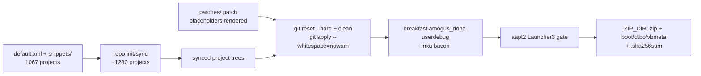

# Repository Guidelines

## Project Overview

Build recipe for an unofficial **crDroid 13.1 (Android 17)** ROM for the Motorola Moto G8 Plus
(`doha`, in-tree device name `amogus_doha`; Snapdragon 665, 4.14 kernel). There are **no Android
sources here**: the repo is a `repo` manifest, 26 per-project patches, one build driver, tools and docs.
Everything else is fetched by `repo sync` from third-party trees (device, vendor blobs, kernel, HALs).

The product is the patch set: each fix in `patches/` is what makes those upstream trees compile and boot
on Android 17. Current branch is `crdroid-android-17` (crDroid manifest branch `17.0`). `main` is the
LineageOS 23.2 (Android 16) build and `lineage-24.0` the LineageOS 24.0 (Android 17) build of the same
device work; crDroid changes never flow back into them.

## Architecture & Data Flow



1. `repo init -u <this clone> -b <current branch> -m default.xml --git-lfs` + `repo sync` materialize
   every project. `default.xml` is crDroid's manifest (branch `17.0`) plus our remotes and includes;
   the 27 doha projects (device trees, blobs, kernel, HALs, AOSPA `device/qcom/*`, `vendor/qcom/common`)
   are pinned in `snippets/doha.xml`. `snippets/crdroid.xml` and `snippets/lineage.xml` are upstream
   copies, never edited.
2. For each `patches/<project path>.patch`, the matching project is reset and the rendered patch applied.
   A patch filename *is* the manifest project path; diff paths are relative to that project's root.
3. An empty **file** `device/motorola/amogus_doha/kernel-headers` is created.
4. `breakfast amogus_doha "$VARIANT"` then `mka bacon`, followed by the `aapt2` Launcher3 resource gate.
5. `crDroidAndroid-*.zip`, `boot/dtbo/vbmeta.img` and a combined `.sha256sum` are copied to `ZIP_DIR`.

Idempotency: `$SRC/.repo/doha-patches` stores `<project> <rendered patch blob> <worktree tree>` per
patched project. The worktree tree includes untracked files (written with a temporary index). If both
match the previous run the project is left untouched (mtimes kept, no rebuild); otherwise it is reset and
re-applied. Removed or renamed patches are reverted. Placeholders are rendered before hashing, so
changing one re-applies the affected patch: `@SKIN_THROTTLE_MC@` (`SKIN_THROTTLE_C * 1000` in
`vendor/qcom/opensource/thermal.patch`), `@DEBLOAT@` (0/1 in `device/motorola/targets.patch`) and
`@UPDATER_CHANNEL@` (`standard`/`debloat` in `packages/apps/Updater.patch`).

## Key Directories

|Path|Purpose|
|---|---|
|`default.xml`|crDroid manifest + our remotes and `<include>`s (1067 `<project>` entries). Do not hand-edit crDroid's entries; touch only our remotes/includes/doha pins.|
|`snippets/doha.xml`|The 27 `local::doha` projects, pinned; starts with two `<remove-project>` entries (`platform/external/fastrpc`, the legacy IPACM project). Ours to edit.|
|`snippets/crdroid.xml`, `snippets/lineage.xml`|Verbatim upstream (64 and 176 projects). Never edit; they are the baseline for the next rebase.|
|`patches/<project path>.patch`|One `git diff` per upstream project; the actual product.|
|`tools/`|`gcp-build.sh` (remote build/release), `flash.sh`, `device-check.sh`, `bugreport-scan.py`, `app-trace.sh`.|
|`gcp-out/`|Fetched artifacts/`build.log`; gitignored, default input for `flash.sh`.|

Patch map (fix → file):

|Patch|What it changes|
|---|---|
|`device/motorola/amogus`|androidboot.boot_devices/`/system` mount, ext4 + 16384 inodes, kernel-header guard, VINTF kernel check off, drop nonexistent bootctrl namespace, thermal label, sepolicy types, `libmdmcutback` blobs|
|`device/motorola/amogus_doha`|`TARGET_SUPPORTS_QUICK_TAP := false`, module load list (haptics/touch/SAR/ToF), explicit recovery touch script, ext4 sizing, Aperture camera overlay|
|`device/motorola/common`|drop `libqsap_sdk`, link `powerhal_flags-aconfig-cc`, fingerprint `fps_id` fallback, Egistec hwservice labels, QCC VINTF removal|
|`device/motorola/targets`|`PRODUCT_VENDOR_KERNEL_HEADERS`, debloat product switch|
|`device/qcom/common`, `device/qcom/sepolicy_vndr/legacy-um`, `device/lineage/sepolicy`|prune duplicate/missing sepolicy types and genfs labels, `vendor_file_type` attributes, `libqsap` removal|
|`frameworks/hardware/interfaces`, `system/tools/hidl`|restore `displayservice@1.0` as a library for the camera HAL|
|`frameworks/base`|register `OP_ACCESS_LOCAL_NETWORK` even with the permission flag off (GMS 26.46 Nearby)|
|`frameworks/libs/systemui`|Launcher3/iconloaderlib tolerates a themed icon resource that vanished after a package update|
|`hardware/interfaces`|healthd power-supply filter on 4.14|
|`hardware/motorola`|stub `libqsap_shim`|
|`hardware/nxp/nfc`|10 ms retry delay for the PN553 NACK-on-wake window|
|`kernel/motorola/msm-4.14`|ramdisk boot past `skip_initramfs`, `close_range()` for tethering, WPA3 `NL80211_WPA_VERSION_3`, double-tap-to-wake, proc cmdline, touch driver fixes|
|`packages/apps/Launcher3`|stale `resources.arsc`/widget-host crash and stuck workspace load|
|`packages/apps/Updater`|own OTA feed URL per channel (`@UPDATER_CHANNEL@`)|
|`packages/modules/Connectivity`|relax 4.14 BPF version gates (bootloop/`system_server` abort)|
|`system/zygote`|treat kernel `EINVAL` on `PR_CAPBSET_READ` as "capability absent" (Chromium renderers on 4.14)|
|`vendor/lineage`|`DEBLOAT_BUILD` gates for Glimpse/Recorder/Twelve|
|`vendor/motorola/amogus`|install the prebuilt `libqsap_sdk` blobs `qcrild` needs (RIL/SIM)|
|`vendor/qcom/common`|skip `wificfr`/`wifilearner` init services, drop QCC GPS HAL/app|
|`vendor/qcom/opensource/audio/sm8150`|C23 `pthread_create` signatures|
|`vendor/qcom/opensource/interfaces`|add `vendor.qti.hardware.fm@1.0` HIDL for the Bluetooth HAL|
|`vendor/qcom/opensource/media/sm8150`|ultra-wide (ov16885) camcorder profiles|
|`vendor/qcom/opensource/thermal`|`xo_therm`/drop `soc`, rename service, `@SKIN_THROTTLE_MC@`|

## Development Commands

```sh
# Full build via Docker (toolchain only; build.sh replaces the entrypoint,
# so the image's LineageOS patches never run)
docker run --rm -it --user "$(id -u):$(id -g)" -e HOME=/tmp \
  -v "$PWD:/manifest:ro" -v ~/android/crdroid-17.0:/src \
  -v ~/android/ccache/doha:/ccache -e CCACHE_DIR=/ccache \
  -v ~/doha/zips:/zips -e ZIP_DIR=/zips \
  --entrypoint /manifest/build.sh \
  lineageos4microg/docker-lineage-cicd:latest /src

./build.sh ~/android/crdroid-17.0      # host with repo + AOSP deps
SKIP_SYNC=1 ./build.sh ~/android/crdroid-17.0   # iterate on an existing tree

# Regenerate a patch after editing inside the synced tree
git -C ~/android/crdroid-17.0/kernel/motorola/msm-4.14 diff \
  > patches/kernel/motorola/msm-4.14.patch

# Only cheap checks that exist
bash -n build.sh
bash -n tools/gcp-build.sh
git apply --check patches/<path>.patch   # inside a matching scratch tree
```

Build-affecting environment variables (pass as `-e NAME=value` in Docker):

|Variable|Effect|Default|
|---|---|---|
|`SKIP_SYNC=1`|skip `repo init`/`repo sync`|off|
|`JOBS`|compile jobs|`nproc`|
|`SYNC_JOBS`|repo sync jobs (Google's git servers 429 above 4)|`4`|
|`REPO_DEPTH`|shallow clone depth|unset = full history (~100 GB)|
|`CCACHE_SIZE`|ccache limit|`50G`|
|`ZIP_DIR`|artifact destination|`zips/` next to the source dir|
|`SKIN_THROTTLE_C`|°C where the thermal HAL reports throttling|`40`|
|`VARIANT`|`userdebug`/`user`/`eng`|`userdebug`|
|`DEBLOAT=1`|omit optional crDroid extras; zip gets `-debloat`, own OTA channel|`0`|
|`ADB_KEY`|test builds only: `adbkey.pub` baked into recovery+system; `-adbkey` zip suffix, never distribute|unset|
|`MANIFEST_URL`, `MANIFEST_BRANCH`|manifest source|this clone / its current branch|

GCP is the CI substitute: `tools/gcp-build.sh create|setup|build|finish`, plus
`state|logs|att|ssh|fetch|delete`, `verify`, `gh-check`, and
`TAG=... tools/gcp-build.sh release|ota` (`OTA_DRY=--dry-run`). Defaults: project
`customrom-514215`, zone `asia-south1-a`, `MACHINE=n2-custom-12-49152`,
one 500 GB `pd-standard` (`SSD_COUNT=0`), `HOURS=48`, `REPO_DEPTH=1`. `create` refuses a machine wider
than the `CPUS_ALL_REGIONS` quota; there is no stop/resize. The VM clones this repo and builds
`origin/$BRANCH`, so commit **and push** before `build`. One tag per build date holds both variants.

`tools/gcp-build-both.sh` builds standard and debloat on **one** VM: standard build,
`finish` with `NO_DELETE=1`, then debloat build and final `finish`. Both use the same `TAG`, so
they land in one release; each `finish` updates only its own OTA channel.

Phone side (adb/fastboot in PATH):

```sh
tools/flash.sh gcp-out --list            # then rerun without --list
tools/device-check.sh [--verbose]        # read-only; exit status = FAIL count
tools/bugreport-scan.py br.zip [--area radio] [--max 6]
tools/app-trace.sh com.example.app 60 [--no-launch]
```

## Code Conventions & Common Patterns

- **Shell**: plain bash, `set -euo pipefail`; defaults as `${VAR:-default}`. `envsetup.sh`,
  `breakfast` and `mka` are sourced with `set +eu` and checked by hand. `build.sh` must stay
  re-runnable.
- **Patches**: edit inside the synced project, then `git diff > patches/<project path>.patch`. New
  files must be staged (`git add -N`) before diffing — build.sh's `git clean -fd` deletes untracked
  files. Patches are plain `git diff` output applied with `git apply --whitespace=nowarn`; no
  `a/`,`b/` rewriting or format-patch metadata.
- **Rebase target**: crDroid forks ~64 core projects (`system/core`, `hardware/interfaces`,
  `packages/modules/Connectivity`, `device/lineage/sepolicy`, `vendor/lineage`, ...). Rebase those
  patches onto crDroid's file versions, never LineageOS's.
- **Kernel**: our fork `ishwar-chandra/android_kernel_motorola_msm-4.14`; `lts` carries the
  4.14.357 baseline, and the build currently pins `73b7957` on
  `doha-kernel-fixes-2026-11-19`. Either extend
  `patches/kernel/motorola/msm-4.14.patch` or land the change in the fork and bump that project's
  `revision` in `snippets/doha.xml`.
- **Docs discipline**: every fix gets a README section naming its patch(es) and symptom. A patch
  change without a README update is a maintenance hazard; untested fixes must say so (e.g. the
  Egistec fingerprint labels).
- **Commit before syncing**: without `SKIP_SYNC=1`, `build.sh` refuses to run when `default.xml` is
  dirty, because `repo` reads the committed manifest while patches come from the working tree. The
  gate checks `default.xml` only: an edited `snippets/doha.xml` is equally invisible to `repo init`
  until committed.
- **Commit messages**: plain-language subject with optional area prefix (`build.sh:`, `README:`,
  `gcp-build:`, `kernel:`, `tools:`), tracking issue suffix `(doha_android#N)`; merges are
  `Merge <branch> into <branch>: <summary> (doha_android#N)`.
- **State**: no DI/framework conventions apply; the shared contracts are the manifest project path,
  the patch filename, the stamp format and the artifact naming (`<zipname>[-debloat][-adbkey]`).

## Important Files

|File|Why it matters|
|---|---|
|`build.sh`|Only build entry point: sync, patch, build, gate, copy artifacts|
|`default.xml`, `snippets/*.xml`|Source pinning; `snippets/doha.xml` is ours|
|`patches/**` (24 files)|The product; each fix mirrored by a README section|
|`README.md`|Authoritative design record: requirements, install/flash/GApps/Magisk, Status, per-fix rationale|
|`GUIDE.md`|Step-by-step local + GCP build, flash, GApps, root, release|
|`CLAUDE.md`|Repo rules and the "Changing a fix" workflow|
|`TODO.md`|Live hardware-issue worklist with on-device evidence (VoLTE, touch, charging, sensors)|
|`BUGREPORT.md`|On-device sweep results: defects, evidence, what was ruled out|
|`tools/gcp-build.sh`|Remote build cycle, GitHub release and OTA feed; no persistent backup|
|`tools/gcp-build-both.sh`|Standard then debloat on one VM; one shared release tag|

## Runtime/Tooling Preferences

- x86-64 Linux, bash, `git`, `repo`, Git LFS (`repo init ... --git-lfs`).
- Docker image `lineageos4microg/docker-lineage-cicd` is used **only** as a toolchain; its
  entrypoint/patches are replaced/never run.
- Resources: ~350 GB disk, ~100 GB RAM+swap for Soong analysis; warm ccache rebuilds ~12 min.
- No Node/Bun/package manager and nothing to install. `tools/bugreport-scan.py` is stdlib-only
  python3; everything else is shell + the Android build.
- Release is `userdebug`, unsigned (AOSP test keys), no GApps. The docker-lineage-cicd SafetyNet
  patch must stay off: crDroid's `system/core` does it (`SPOOF_SAFETYNET=1`).

## Testing & QA

- **There is no test suite, linter, CI or fixtures. Do not invent test commands.** `bash -n` is the
  only cheap static check; patch correctness is proven by applying it and building.
- Verification is a full build plus flashing to real hardware: `tools/flash.sh gcp-out` (checksum
  verified; images to both slots, zip sideloaded into the inactive slot) or manual `fastboot flash
  boot/dtbo/vbmeta` + `adb sideload`. A failed compile, the `aapt2` Launcher3 gate or a bootloop is
  the feedback loop.
- Automated on-device pass: `tools/device-check.sh` prints PASS/WARN/FAIL/SKIP and exits with the
  number of FAILs, so it can gate a release. What needs a human is SKIP with a suggestion; use the
  README "Status" checklist (calls, SMS/data, Wi-Fi, cameras, fingerprint enrolment, audio, GNSS,
  NFC, Magisk).
- For a specific failure: `adb bugreport ./br.zip` + `tools/bugreport-scan.py`, or
  `tools/app-trace.sh <pkg>` for one app. All read-only on device; `app-trace` writes under
  `./app-trace/`.
- Artifact integrity: `sha256sum -c <name>.sha256sum` (also done by `gcp-build.sh verify` and by
  `flash.sh` before touching the phone).
- Status to respect: the crDroid build boots on hardware (first flashed 2026-11-17); the inherited
  hardware checklist still needs a full re-run. Untested: double-tap-to-wake (patched, FocalTech
  only), Himax/Novatek panels, Egistec fingerprint, dual-SIM XT2019-2. Known: VoLTE depends on the
  modem carrier profile; first boot from stock may be 2G-only until one reboot.

## Pitfalls

- `device/motorola/amogus_doha/kernel-headers` must be an empty **file** created by `build.sh`, never
  committed. A directory there enters the include path and shadows bionic's headers (`redefinition
  of 'sigaction'`). Real headers come from `PRODUCT_VENDOR_KERNEL_HEADERS` in
  `patches/device/motorola/targets.patch`.
- Any syncing run overwrites local changes in **every** project; hand edits survive only with
  `SKIP_SYNC=1`, and only until the next sync. Change the patch, not the tree.
- crDroid's `bacon` renames the OTA zip and deletes target-files intermediates: there is no
  `lineage_amogus_doha-ota.zip` and no `IMAGES/`. Read images from `PRODUCT_OUT`; do not ask for
  `target-files-package` (ninja races bacon's cleanup).
- Launcher3 can ship a `resources.arsc` older than its code; the missing `widget_internal_focus_bg`
  crashes the widget host and silently disables home-screen drags. Only a build from an empty `out/`
  fixes it; the `aapt2` gate must fail instead of shipping it.
- `vendor/extra/` is generated only for `ADB_KEY` builds and deleted otherwise; never commit it or
  distribute an `-adbkey` zip.
- `userdebug` still reports `ro.build.type=user`, `ro.debuggable=0` (crDroid sets
  `PRODUCT_NOT_DEBUGGABLE_IN_USERDEBUG`): no `adb root`, no `dmesg`; pstore only from recovery.
- crDroid's version ≠ Android version: branch `17.0` is crDroid **13.1**, artifact
  `crDroidAndroid-17.0-<date>-amogus_doha-v13.1.zip`; another build of the same variant that day
  replaces that day's files in `ZIP_DIR`. Images are named after their zip so standard and debloat
  coexist and do not overwrite each other.
