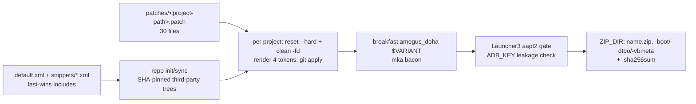

# Repository Guidelines

Build recipe for an unofficial **crDroid 13.1 (Android 17)** ROM on the Motorola Moto G8 Plus
(`doha`, in-tree device `amogus_doha`; Snapdragon 665/trinket, 4.14 kernel, LineageOS 24.0 base).
This repository is **not** an Android source tree: no `src/`, no app code, no tests. Its product is
**30 patch files** pinned against third-party trees by a `repo` manifest, driven by `build.sh` and
`tools/`.

## Project Overview

- Manifest branch `17.0` is crDroid **13.1**, not Android 13. Artifacts read
  `crDroidAndroid-17.0-<YYYYMMDD>-amogus_doha-v13.1[-debloat][-adbkey]`.
- Branches on `origin`: `crdroid-android-17` (integration), `performance-tuning` (daily work),
  `lineage-24.0`, `ext4-system-53`. **There is no `main`** and no `master` — docs that mention
  `main` are stale. Builds use the branch checked out here (`tools/gcp-build.sh` derives
  `BRANCH` from HEAD); untested work stays on `performance-tuning` and is merged into
  `crdroid-android-17` only after device testing. Never merge crDroid work back into the
  LineageOS lines.
- The patch set is the deliverable. `README.md` is the design record and per-fix rationale: an
  undocumented patch is a maintenance hazard, and a new patch must get a section there.

## Architecture & Data Flow



Manifest composition, all included by `default.xml` (1031 own projects, 7 remotes, default revision
`refs/heads/lineage-24.0`), **last include wins**:

|Include|Live projects|Role|
|---|---|---|
|`snippets/crdroid.xml`|64 crDroid forks (`refs/heads/17.0`)|never edit|
|`snippets/lineage.xml`|158 LineageOS projects|never edit|
|`snippets/doha.xml`|27 SHA-pinned `local::doha` projects + **2 `<remove-project>`**|owned here|

`doha.xml` removes AOSP `platform/external/fastrpc` (AOSPA copy wins) and LineageOS IPACM at
`vendor/qcom/opensource/data-ipa-cfg-mgr-legacy-um` (removed by name **and** path so moto-common's
`data-ipa-cfg-mgr-legacy` wins without dropping other devices' same-named tree). Repo rejects
duplicate paths, so `remove-project` + re-add is the only override mechanism used.

Patch application in `build.sh:132-186`:

1. Project list = `find patches -name '*.patch'`, filename minus `.patch`.
2. Render the four placeholders, then compare rendered blob **and** worktree tree against
   `$SRC/.repo/doha-patches` (one line per project: `<project> <patch-blob> <tree>`; the tree id
   includes untracked files). Both match → skip, preserving mtimes.
3. Otherwise `git reset --hard && git clean -fd` in that project, then
   `git apply --whitespace=nowarn`. One patch per project, so order is irrelevant.
4. Patches deleted since the last run are reverted (their project is reset).
5. An empty **file** `device/motorola/amogus_doha/kernel-headers` is created after patching, before
   the stamp is written; real headers come from `PRODUCT_VENDOR_KERNEL_HEADERS`
   (`patches/device/motorola/targets.patch`).

Rendered knobs (changing one re-applies exactly the affected patches):

|Token|Value|Patch location|
|---|---|---|
|`@SKIN_THROTTLE_MC@`|`SKIN_THROTTLE_C * 1000`|`patches/vendor/qcom/opensource/thermal.patch:26`|
|`@DEBLOAT@`|`0`/`1`|`patches/device/motorola/targets.patch:60` (consumed as `DEBLOAT_BUILD` by `patches/vendor/lineage.patch`)|
|`@READAHEAD_KB@`|`READAHEAD_KB`|`patches/device/motorola/amogus.patch:186`, `patches/device/qcom/common.patch:256,324`|
|`@UPDATER_CHANNEL@`|`standard`/`debloat`|`patches/packages/apps/Updater.patch:10,13,30`|

Patch groups (30 total):

|Area|Patches|Representative change|
|---|---|---|
|Device, storage, policy|8: `device/motorola/{amogus,amogus_doha,common,targets}`, `device/lineage/sepolicy`, `device/qcom/common`, `device/qcom/sepolicy_vndr/legacy-um`, `system/sepolicy`|ext4 system + `/metadata`, `nodiscard` on `/data`, zram 4 GiB, single read-ahead writer, sepolicy dedupe, Dolby Atmos (DMS HAL + `libswdap`, AudioFX removed)|
|Android 17 on 4.14|7: `kernel/motorola/msm-4.14`, `packages/modules/Connectivity`, `hardware/interfaces`, `system/zygote`, `frameworks/base`, `art`, `frameworks/av`|`CONFIG_INITRAMFS_IGNORE_SKIP_FLAG`, `/proc/cmdline` bounds, BPF gates→warn, capability-bound `EINVAL` no longer panics, AppOp registration, pre-reboot dexopt symlink, frozen-callback `ENOSYS`|
|Vendor, HIDL, blobs|11: `vendor/motorola/*`, `vendor/qcom/common`, `vendor/qcom/opensource/{audio/sm8150,interfaces,media/sm8150,thermal}`, `frameworks/hardware/interfaces`, `system/tools/hidl`, `hardware/{motorola,nxp/nfc}`|OEMCrypto, camera blob delta, restored `displayservice@1.0`/`fmt@1.0`, QCC/wificfr removal, thermal HAL rename|
|Product, OTA, debloat|3: `vendor/lineage`, `packages/apps/Updater`, `packages/apps/crDroidSettings`|`DEBLOAT_BUILD` gating, per-channel OTA JSON, dead-preference pruning|
|Launcher|1: `packages/apps/Launcher3`|`workspaceLoading` reset in `finally`, missing-drawable guard, DT2S default on|

## Key Directories

|Path|Purpose|
|---|---|
|`build.sh`|Only build entry point: validate, sync, render/apply patches, build, gates, copy artifacts|
|`default.xml`, `snippets/*.xml`|Remotes, includes, removals, exact revisions|
|`patches/**`|The 30 fixes; one diff per manifest project (two are binary: `patches/vendor/motorola/amogus.patch`, `patches/device/motorola/amogus_doha.patch`)|
|`tools/`|13 scripts (11 bash + 2 stdlib Python: `bugreport-scan.py`, `logfmt.py`) + `gms-trim.components`|
|`docs/`|`GUIDE.md` procedures, `TODO.md` worklist, `BUGREPORT.md` evidence, `OPTIMIZATION.md` measured tuning, `README.md` index|
|`gcp-out/`|Gitignored artifact dir; default for `tools/flash.sh`|
|`bugreports/`|Gitignored bugreport archives|
|`.repo/doha-patches`|Per-run stamp inside the synced tree; never in this repo|

## Development Commands

```sh
./build.sh ~/android/crdroid-17.0               # sync + patch + build
SKIP_SYNC=1 ./build.sh ~/android/crdroid-17.0   # skip init/sync; patch checks still run

# Docker supplies only the toolchain; the entrypoint override skips the image's own patches.
docker run --rm -it --user "$(id -u):$(id -g)" -e HOME=/tmp \
  -v "$PWD:/manifest:ro" -v ~/android/crdroid-17.0:/src \
  -v ~/android/ccache/doha:/ccache -e CCACHE_DIR=/ccache \
  -v ~/doha/zips:/zips -e ZIP_DIR=/zips \
  --entrypoint /manifest/build.sh \
  lineageos4microg/docker-lineage-cicd:latest /src
```

`build.sh` takes one positional arg (SOURCE_DIR, default `./crdroid`) and has **no option parser**;
unknown paths are created by `mkdir -p`. Only `DEBLOAT`, `OTA_CHANNEL`, `SKIN_THROTTLE_C`,
`READAHEAD_KB` are validated; `VARIANT` is not.

|Variable|Default|Effect|
|---|---|---|
|`JOBS`|`nproc`|`mka -j`|
|`SYNC_JOBS`|`4`|`repo sync -j`; higher values hit Google HTTP 429|
|`REPO_DEPTH`|unset|`repo init --depth`; needs servers to serve every pin|
|`SKIP_SYNC`|off|Only the literal `1` skips sync and the dirty-manifest gate|
|`MANIFEST_URL`/`MANIFEST_BRANCH`|this checkout / current branch|`repo init` source|
|`VARIANT`|`userdebug`|`breakfast` variant; behaviorally equal to `user` (see below)|
|`ZIP_DIR`|`<source parent>/zips`|Shared by both variants|
|`DEBLOAT`|`0`|`1` drops extras, adds `-debloat`, selects the debloat OTA channel|
|`OTA_CHANNEL`|from `DEBLOAT`|`standard`/`debloat`/`test` feed baked into the Updater; `test` requires `DEBLOAT=0`|
|`SKIN_THROTTLE_C`|`40`|Whole °C, rendered ×1000|
|`READAHEAD_KB`|`128`|Whole KB, rendered into two patches|
|`CCACHE_SIZE`|`50G`|ccache limit|
|`ADB_KEY`|unset|Test-only `adbkey.pub` (must start `QAAAA`); adds `-adbkey`; never distribute|

Artifacts copied to `ZIP_DIR`: `<name>.zip`, `<name>-boot.img`, `<name>-dtbo.img`,
`<name>-vbmeta.img`, `<name>.sha256sum` (bare basenames, so `sha256sum -c` works in that dir).
Images are **never** plain `boot.img`: standard and debloat builds share `ZIP_DIR`.

Regenerate a patch from the synced tree (never hand-edit `patches/` apart from the worktree):

```sh
# Modified file
git -C ~/android/crdroid-17.0/kernel/motorola/msm-4.14 diff > patches/kernel/motorola/msm-4.14.patch
# New file: stage intent first, or clean -fd deletes it and the diff omits it
git -C ~/android/crdroid-17.0/device/motorola/amogus_doha add -N path/to/new_file
# Binary blob (vendor/motorola/amogus only)
git -C ~/android/crdroid-17.0/vendor/motorola/amogus diff --binary > patches/vendor/motorola/amogus.patch
```

Release/device operations: `tools/gcp-build.sh create|setup|gh-check|build|state|logs|verify|release|ota|finish|auto-finish|fetch|delete`.
`logs [--full]` formats the tail or streams the raw log; the VM is discovered
from the gcloud project (`NAME`/`ZONE` select one of several; `create` labels
new VMs `doha-build=1`). Also
`tools/gcp-build-both.sh` (both variants, one VM/TAG, separate OTA channels),
`tools/drive-backup.sh backup|restore|status`, `tools/flash.sh gcp-out --list` then without
`--list` to flash.

## Code Conventions & Common Patterns

- **Shell**: `#!/usr/bin/env bash`, `set -euo pipefail`, `${VAR:-default}`, `die()`, `case` dispatch,
  `usage()`, argument validation before side effects, re-runnable. `device-check.sh`,
  `perf-audit.sh`, `perf-multitask.sh` deliberately use `set -uo pipefail` (no `-e`) so one failed
  `adb` probe does not kill the sweep. `build.sh` drops `-eu` around `envsetup.sh`/`breakfast`/`mka`
  and checks statuses instead.
- **Patch format**: plain `git diff` with `a/`/`b/` paths, applied by `git apply --whitespace=nowarn`
  after a hard reset; no path rewriting. Two `GIT binary patch` files
  (`patches/vendor/motorola/amogus.patch`, `patches/device/motorola/amogus_doha.patch`).
  `patches/system/zygote.patch` carries a prose preamble
  before the diff — regenerating with plain `git diff` drops that rationale.
  `patches/device/qcom/common.patch` empties 11 files to the empty blob
  (`..e69de29b`) instead of deleting them; new files appear as `new file mode` (18 of them, so
  `git add -N` matters).
- **Rebase target**: crDroid forks (`refs/heads/17.0`) for `device/lineage/sepolicy`,
  `frameworks/base`, `hardware/interfaces`, `packages/apps/{crDroidSettings,Launcher3,Updater}`,
  `packages/modules/Connectivity`, `system/sepolicy`, `vendor/lineage`; LineageOS upstream for
  `device/qcom/sepolicy_vndr/legacy-um`, `frameworks/hardware/interfaces`, `hardware/nxp/nfc`,
  `vendor/qcom/opensource/interfaces`; AOSP for `system/tools/hidl`, `system/zygote`.
- **Kernel**: either extend `patches/kernel/motorola/msm-4.14.patch`, or land it in
  `ishwar-chandra/android_kernel_motorola_msm-4.14` (branch `lts`) and bump the SHA pin in
  `snippets/doha.xml` (`def1be59…`). Never leave a fix in both places.
- **Comments**: state the device-specific trigger and why the workaround exists; cite the
  `doha_android#N` issue and sibling patch. Keep license headers, match module style.
- **Commits**: lowercase area prefix + imperative subject, no period (`build.sh:`, `kernel:`,
  `device:`, `tools:`, `docs:`, `sepolicy:`, `snippets:`). Integration merges read
  `Merge performance-tuning into crdroid-android-17: <summary>`. The documented
  `(doha_android#N)` suffix appears in ~1% of subjects, so do not assume it.
- **README rule**: every fix gets a README section naming its patch and symptom; mark
  device-untested fixes explicitly. Currently missing sections: `packages/apps/Updater`,
  `system/zygote`, `vendor/qcom/opensource/media/sm8150`; `vendor/lineage` and
  `hardware/interfaces` are described but never named as files.
- **Manifest changes must be committed before building**: `repo init` reads only committed
  `default.xml`/snippets, and `build.sh:92` refuses a dirty `default.xml` (snippets are *not*
  gated — an uncommitted `doha.xml` silently does nothing).

Invariants:

- Run **`mka bacon` only**. Adding `target-files-package` races bacon's cleanup of the staging dir.
  crDroid leaves no `IMAGES/` and no `lineage_amogus_doha-ota.zip`; read images from `PRODUCT_OUT`.
- `vendor/extra/` exists only for `ADB_KEY` builds, is `rm -rf`'d every run, and must never be
  committed. Without `ADB_KEY`, stale key files in `out/` fail the build by design.
- `kernel-headers` is an empty **file**, not a directory; a directory shadows bionic headers.
- A syncing run destroys hand edits in every project. Durable changes belong in `patches/` or a
  fork.

**Documentation:** the prose is kept in sync with the code; if a doc disagrees, the code is authoritative.

## Important Files

|File|Purpose|
|---|---|
|`build.sh`|Sync, render/apply, build, Launcher3 `aapt2` gate, ADB-key leakage check, artifact copy|
|`default.xml`|crDroid manifest + our remotes/includes; local edits deliberate|
|`snippets/doha.xml`|27 pinned doha projects and the 2 removals|
|`patches/vendor/motorola/amogus.patch`|Binary patch (`--binary` required on regeneration); the other is `patches/device/motorola/amogus_doha.patch`|
|`patches/device/motorola/amogus_doha.patch`|Dolby prebuilts, package list, sepolicy, props; also the device tree's boot/config changes|
|`patches/device/motorola/amogus.patch`|fstab/boot cmdline/ext4/zram/read-ahead — most device behavior|
|`patches/device/qcom/common.patch`|Single surviving read-ahead writer; 11 emptied sepolicy files|
|`patches/kernel/motorola/msm-4.14.patch`|Android-17 initramfs/`/proc/cmdline`, WPA3, touch, defconfig|
|`tools/gcp-build.sh`|Remote build → verify → GitHub release → OTA feed; discovers the project/VM from gcloud (`NAME`/`ZONE` override, `create` labels `doha-build=1`); `logs [--full]` formatted/raw; every ssh/scp addresses the VM as the account that ran `setup` (recorded in instance metadata, `VUSER` overrides) because `build.log`, `build.exit`, `build.channel` and the tmux socket live in that account's `$HOME`; `finish` polls the VM's `build.exit`, then deletes the VM (kept on failure); `promote` copies a tested `test/doha.json` entry to `standard/`|
|`tools/logfmt.py`|`logs` formatter: width wrapping, repeat dedupe, noise filtering, progress bars, `--full` raw mode|
|`device/motorola/amogus_doha/dolby`|Stock-10 Moto Audio/`daxService` APKs, DMS HIDL service/libs, `libswdap`, `dax-default.xml`; APKs are `BUILD_PREBUILT`, copied by `device.mk`|
|`tools/device-check.sh`, `tools/perf-audit.sh`, `tools/perf-multitask.sh`|Release-gating hardware checks|
|`tools/flash.sh`|Set discovery via `.sha256sum`, checksum verify, both-slot flash + sideload|
|`tools/integrity-setup.sh`|TrickyStore keybox import; the repo never ships a keybox|

## Runtime/Tooling Preferences

- **Host**: x86-64 Linux, `bash`, `git`, `repo`, Git LFS, AOSP build deps, `adb`/`fastboot`;
  `gcloud`, `curl`, `python3`, GitHub token for GCP/release work. No Node/Bun, no JS package
  manager, no dependency manifest. Python is stdlib-only.
- **Container**: `lineageos4microg/docker-lineage-cicd:latest` is a toolchain only; `build.sh`
  replaces the entrypoint so the image's LineageOS/SafetyNet patches never run.
- **Resources**: ~350 GB disk (~200 GB sources, ~120 GB `out/`, ≤50 GB ccache) and ~100 GB
  RAM+swap for Soong analysis.
- **GCP path**: `gcloud` local, `gh` installed on the VM, token only crossing over; builds run on
  `n2-custom-12-49152` with 2×375 GB local NVMe.
- **Release properties**: unsigned AOSP test keys, no GApps. Both `user` and `userdebug` report
  `ro.build.type=user`/`ro.debuggable=0`: no `adb root`, no shell `dmesg`, pstore needs recovery.
  Variant is not recoverable from artifacts — use separate output dirs.
- **Play Integrity**: doha's vendor keymaster refuses attestation (`-10003`); fingerprint/prop
  spoofing does not fix it. Supported route is TrickyStore plus a user-supplied keybox. Never
  commit, download, or distribute a keybox.

## Testing & QA

**There is no test suite, fixture set, linter, CI workflow, or coverage target. Do not invent test
commands.** The feedback loop is static checks → patch application → full Android build → artifact
verification → real hardware.

Cheap checks:

```sh
bash -n build.sh
bash -n tools/<changed-script>.sh
python3 -m py_compile tools/logfmt.py
python3 -c 'import xml.dom.minidom as m; m.parse("snippets/doha.xml")'
# From a pristine checkout of the matching pinned project, not this manifest root:
git -C <project> apply --check --whitespace=nowarn patches/<project-path>.patch
```

`git apply --check` is not compilation. `build.sh` gates the Launcher3 APK with `aapt2`
(`widget_internal_focus_bg`); missing means a stale `resources.arsc` — delete `out/` and rebuild,
a module-level clean is insufficient. With no `aapt2`, it only warns.

An interrupted `repo sync` can leave a project whose HEAD still matches its pin with every file
staged as deleted; `repo sync` then skips it, and a full Soong analysis fails on a missing
prebuilt. Find them with `repo forall -c 'git diff --cached --quiet || echo $REPO_PATH'` and
restore each with `git -C <project> checkout -f HEAD -- .` (the objects are local; no re-sync).

Removing a package from `PRODUCT_PACKAGES` does not shrink the fixed partitions; run
`mka installclean` (or a separate `OUT`) first or the stale staging APK survives. Android 17
rejects APKs in `PRODUCT_COPY_FILES`: use a `BUILD_PREBUILT` APPS module (`LOCAL_CERTIFICATE :=
PRESIGNED`, plus `LOCAL_PRIVILEGED_MODULE := true` for a priv-app). A prebuilt whose manifest
declares `<uses-library>` must match the build system: set `LOCAL_USES_LIBRARIES` only when that
name is a real `JAVA_LIBRARIES` module (otherwise the module's `dexpreopt.config` depends on a
config with no rule), otherwise set `LOCAL_ENFORCE_USES_LIBRARIES := false` on that module alone
(`MotoDolbyV3` needs this); never the product-wide `PRODUCT_BROKEN_VERIFY_USES_LIBRARIES`.

Artifact validation:

```sh
(cd gcp-out && sha256sum -c crDroidAndroid-*.sha256sum)
tools/flash.sh gcp-out --list      # detection only
tools/flash.sh gcp-out --dry-run   # no flash
```

On-device verification — each tool proves only its own claim:

|Tool|Exit / semantics|
|---|---|
|`tools/device-check.sh [--verbose]`|PASS/WARN/FAIL/SKIP per line; exit = FAIL count (cap 99); read-only except a 4-byte `/sdcard` probe|
|`tools/perf-audit.sh`|Same FAIL-count exit; read-only; root-only I/O knobs report SKIP; override `READAHEAD_KB`/`ZRAM_MB`/`SKIN_THROTTLE_C` for older builds; `PERF_AUDIT_ROOT` runs against fixtures|
|`tools/perf-multitask.sh [--repeat N]`|Cold/warm app probe; force-stops its app set; exit 2 bad args, 3 device lost|
|`tools/bugreport-scan.py <br.zip> [--area A] [--max N]`|Always exits 0 even with findings — never use as a gate|
|`tools/app-trace.sh <pkg> [secs] [--no-launch]`|Writes `./app-trace/<pkg>-<ts>/`|
|`tools/dexopt-all.sh [-m MODE] [--wait]`|`MODE`: `speed-profile` (default), `verify`, `speed`; `speed` is a measured regression|
|`tools/gms-trim.sh` (`--list`, `--dry-run`, `--restore`)|State in gitignored `tools/.gms-trim.state`|
|`tools/integrity-setup.sh` (`status`, `import <keybox>`, `clear`, `check`)|Device-only `Settings.Secure` changes; no root|

- SKIP and WARN are not passes; SKIP means a human or root is still needed.
- Runtime knobs have multiple init writers, so never infer effective tuning from one source file;
  use `perf-audit.sh` and treat unavailable queue/`dm-*` reads as SKIP.
- Manual checklist lives in README **Status**: calls/SMS/data/Wi-Fi, cameras, fingerprint, audio,
  GNSS, NFC, Magisk, GApps sign-in. Incompletely verified: Himax/Novatek panels, Egistec
  fingerprint, dual-SIM XT2019-2, double-tap-to-wake.
- Patch projects whose docs call them device-untested: `device/motorola/common` (Egistec labels),
  `vendor/motorola/common` (OEMCrypto/Widevine), kernel sched-downmigrate gate,
  `device/motorola/amogus_doha` (Doze motion off), `frameworks/base` (local-network AppOp),
  `system/sepolicy` + `device/lineage/sepolicy` (suspend rules), `crDroidSettings`
  (TrickyStore migration).
- Never promote `code-fixed`, a green build, or a passing static check to device-verified without
  a new flash and the relevant hardware check.
