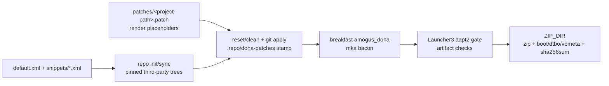

# Repository Guidelines

## Project Overview

Build recipe for an unofficial **crDroid 13.1 (Android 17, LineageOS 24.0 base)** ROM for the
Motorola Moto G8 Plus (`doha`; in-tree device `amogus_doha`, Snapdragon 665, 4.14 kernel). This is
**not a materialized Android source tree**: `default.xml` and `snippets/` fetch third-party sources,
28 per-project patches adapt them, and `build.sh` plus `tools/` build, release, flash, and verify them.

The patch set is the product. crDroid manifest branch `17.0` means crDroid **13.1**, not Android 13;
artifacts still use `crDroidAndroid-17.0-...-v13.1.zip`. Work normally lands on `performance-tuning`
and is merged into release branch `crdroid-android-17` before building. `main` (LineageOS 23.2 /
Android 16) and `lineage-24.0` (LineageOS 24.0 / Android 17) are separate lines; do not flow crDroid
changes back into them automatically.

## Architecture & Data Flow



`default.xml` combines the LineageOS 24.0/crDroid 17.0 sources with our remotes and three includes.
`snippets/doha.xml` is ours: 27 revision-pinned `local::doha` projects plus two removals. The crDroid
and Lineage snippets are verbatim upstream rebase baselines, not local configuration to edit.

A patch filename **is** the manifest project path; its diff paths are relative to that project root.
Before applying, `build.sh` runs `git reset --hard` and `git clean -fd`. The stamp records the rendered
patch hash and full worktree tree (including untracked files): unchanged projects keep their mtimes,
changed ones are reapplied, and removed/renamed patches are reverted. Patch order must remain irrelevant.

Major subsystems:

|Area|Representative patches|Responsibility|
|---|---|---|
|Device, storage, policy|`device/motorola/{amogus,amogus_doha,common,targets}.patch`, `device/qcom/common.patch`, `system/sepolicy.patch`|boot/mounts, ext4/zram, kernel headers, HAL flags, sepolicy, runtime knobs|
|Android 17 on 4.14|`kernel/motorola/msm-4.14.patch`, `packages/modules/Connectivity.patch`, `hardware/interfaces.patch`, `system/zygote.patch`|boot/touch/tethering, BPF compatibility, capabilities|
|Vendor and HIDL|`vendor/motorola/amogus.patch`, `vendor/motorola/common.patch`, `vendor/qcom/**`, `frameworks/hardware/interfaces.patch`, `system/tools/hidl.patch`, `hardware/nxp/nfc.patch`|RIL/camera/FM/NFC blobs, Widevine OEMCrypto packaging, interfaces, and services|
|Product and OTA|`packages/apps/{crDroidSettings,Launcher3,Updater}.patch`, `vendor/lineage.patch`, `device/motorola/targets.patch`|debloat behavior, launcher stability, keybox prompt, per-channel OTA|

Use `README.md`'s per-fix sections for the complete patch/symptom map. `build.sh` also creates the empty
**file** `device/motorola/amogus_doha/kernel-headers`; this is an include-path guard, not real headers.

## Key Directories

|Path|Purpose|
|---|---|
|`snippets/`|Manifest includes; only `doha.xml` is locally owned. The other two are upstream baselines.|
|`patches/`|The deliverable: one plain `git diff` per synced project, named `<project path>.patch`.|
|`tools/`|Self-contained bash/python operational tools; `build.sh` does not invoke them.|
|`docs/`|Build guide, optimization record, live hardware worklist, and bugreport evidence.|
|`gcp-out/`|Gitignored fetched zips/images/logs; default artifact directory for `tools/flash.sh`.|
|`bugreports/`|Gitignored diagnostic archives. `app-trace.sh` separately writes `./app-trace/`.|

There is no local `src/`, `test/`, or package directory to edit. Android project changes belong in a patch
or in the pinned upstream fork, never only in a synced worktree.

## Development Commands

```sh
# Host with repo and AOSP build dependencies; keep sources outside this checkout.
./build.sh ~/android/crdroid-17.0
SKIP_SYNC=1 ./build.sh ~/android/crdroid-17.0   # skip repo init/sync; patch checks still run

# Docker supplies only the toolchain; our entrypoint replaces the image's own patches.
docker run --rm -it --user "$(id -u):$(id -g)" -e HOME=/tmp \
  -v "$PWD:/manifest:ro" -v ~/android/crdroid-17.0:/src \
  -v ~/android/ccache/doha:/ccache -e CCACHE_DIR=/ccache \
  -v ~/doha/zips:/zips -e ZIP_DIR=/zips \
  --entrypoint /manifest/build.sh \
  lineageos4microg/docker-lineage-cicd:latest /src

# Regenerate a patch after editing the synced project (git add -N new files first).
git -C ~/android/crdroid-17.0/kernel/motorola/msm-4.14 diff \
  > patches/kernel/motorola/msm-4.14.patch
```

Bare `./build.sh` defaults to `./crdroid` and `./zips`, which are not gitignored; pass an external
source directory as above. A syncing run destroys hand edits in synced projects. A non-syncing run
preserves them temporarily, but durable changes must return to `patches/` or an upstream fork.

Build-affecting variables (pass as `-e NAME=value` in Docker):

|Variable|Default|Effect|
|---|---|---|
|`SKIP_SYNC=1`|off|Skip `repo init`/`repo sync` and the dirty-manifest gate.|
|`JOBS`, `SYNC_JOBS`|`nproc`, `4`|Compile/sync parallelism; higher Google sync counts can trigger HTTP 429.|
|`REPO_DEPTH`|unset|Shallow clone depth; unset fetches full history (~100 GB).|
|`CCACHE_SIZE`|`50G`|Compiler cache limit.|
|`ZIP_DIR`|`<source parent>/zips`|Destination for zip, three images, and `.sha256sum`.|
|`VARIANT`|`userdebug`|`userdebug`, `user`, or `eng`.|
|`DEBLOAT`|`0`|`1` omits optional extras, adds `-debloat`, and selects the debloat OTA channel.|
|`SKIN_THROTTLE_C`|`40`|Whole-number skin throttle temperature, rendered as millidegrees.|
|`READAHEAD_KB`|`128`|Early and runtime read-ahead rendered into `device/motorola/amogus.patch` and `device/qcom/common.patch`.|
|`ADB_KEY`|unset|Test-only adb public key; adds `-adbkey`. Never distribute these artifacts.|
|`MANIFEST_URL`, `MANIFEST_BRANCH`|this checkout / current branch|Manifest source used by `repo init`.|

GCP is the CI substitute:

```sh
tools/gcp-build.sh create
tools/gcp-build.sh setup
tools/gcp-build.sh build       # builds origin/$BRANCH: commit and push first
tools/gcp-build.sh finish      # wait, verify, release, update OTA, delete VM on success
tools/gcp-build-both.sh        # standard then debloat on one VM, one release tag
tools/drive-backup.sh backup   # manual persistent VM backup to personal Drive
```

A failed build/finish keeps the VM. `gcp-build-both.sh` shares one `TAG` but updates separate standard
and debloat OTA channels. `drive-backup.sh restore` requires `create` + `setup`; backup is not part of
the automatic build chain. Use `tools/gcp-build.sh state|logs|fetch|verify` for routine inspection.

Common device operations (require adb; some mutate state):

```sh
tools/dexopt-all.sh -m speed-profile --wait
tools/gms-trim.sh --dry-run                 # grouped GMS disables; --restore reverses saved state
tools/integrity-setup.sh status             # import <keybox.xml>, clear, and check are also supported
tools/perf-multitask.sh                     # cold/warm app probe; force-stops its app set
```

## Code Conventions & Common Patterns

- **Shell**: use `#!/usr/bin/env bash`, normally `set -euo pipefail`, `${VAR:-default}` defaults,
  `die()` helpers, and `case` dispatch. Validate arguments before side effects and keep scripts
  re-runnable. `build.sh` deliberately disables strict nounset/errexit around `envsetup.sh`,
  `breakfast`, and `mka`, then checks their statuses. `perf-multitask.sh` intentionally omits `-e`
  so one failed adb probe does not end the sweep.
- **Patch format**: plain `git diff` with normal `a/`/`b/` paths, applied using
  `git apply --whitespace=nowarn`; no format-patch metadata or path rewriting. Stage new files with
  `git add -N` before diffing or `git clean -fd` will remove them. Each patch must apply to its pinned
  revision and remain independent of patch application order.
- **Rebase target**: patches for `device/lineage/sepolicy`, `frameworks/base`, `hardware/interfaces`,
  `packages/apps/{crDroidSettings,Launcher3,Updater}`, `packages/modules/Connectivity`,
  `system/sepolicy`, and `vendor/lineage` target crDroid forks, not LineageOS file versions.
- **Manifest ownership**: in `default.xml`, touch only our remotes/includes/doha pins. Never locally
  edit `snippets/crdroid.xml` or `snippets/lineage.xml`; update them only as upstream rebase baselines.
- **Kernel**: either extend `patches/kernel/motorola/msm-4.14.patch`, or land the change in
  `ishwar-chandra/android_kernel_motorola_msm-4.14` and bump its pinned revision in `snippets/doha.xml`.
- **Code comments**: explain the device-specific trigger and why the workaround is needed; cite the
  tracking issue and sibling patch where useful. Match Android module/generator style for new HAL and
  build files, and retain license headers on new source files.
- **No app framework**: there is no DI, async, or state-management convention. Shared state contracts
  are environment variables, `.repo/doha-patches`, the manifest-project/patch-path mapping, tool state
  files, and artifact names `<zipname>[-debloat][-adbkey]`.

`build.sh` renders exactly four placeholders before hashing/applying; preserve these cross-file contracts:

|Token|Value|Patch|
|---|---|---|
|`@SKIN_THROTTLE_MC@`|`SKIN_THROTTLE_C * 1000`|`vendor/qcom/opensource/thermal.patch`|
|`@DEBLOAT@`|`0` or `1`|`device/motorola/targets.patch`, consumed by `vendor/lineage.patch`|
|`@READAHEAD_KB@`|`READAHEAD_KB`|`device/qcom/common.patch`|
|`@UPDATER_CHANNEL@`|`standard` or `debloat`|`packages/apps/Updater.patch`|

Other invariants:

- Run `mka bacon` only. Adding `target-files-package` races bacon's cleanup; crDroid leaves no
  `IMAGES/` or `lineage_amogus_doha-ota.zip`, so read images from `PRODUCT_OUT`.
- `vendor/extra/` exists only for `ADB_KEY` builds and is removed otherwise; never commit it or ship
  an `-adbkey` zip. The real kernel headers come from `PRODUCT_VENDOR_KERNEL_HEADERS`, not the guard file.
- Commit manifest changes before syncing. The dirty check covers only `default.xml`; an uncommitted
  `snippets/doha.xml` is equally invisible to `repo init`. Patches, by contrast, come from the working tree.
- Every fix needs a `README.md` section naming its patch(es) and symptom. Mark device-untested fixes
  explicitly. Prefer plain commit subjects with an optional area prefix (`build.sh:`, `kernel:`,
  `tools:`) and issue suffix `(doha_android#N)`.

## Important Files

|File|Purpose|
|---|---|
|`build.sh`|Only build entry point: validate, sync, render/apply patches, build, gate, copy artifacts.|
|`default.xml`, `snippets/doha.xml`|Source remotes, includes, removals, and exact third-party revisions.|
|`snippets/crdroid.xml`, `snippets/lineage.xml`|Upstream snapshots used for rebasing; do not treat as local config.|
|`patches/**`|The 28 fixes that make the pinned sources compile and boot; mirror each in `README.md`.|
|`README.md`|Authoritative design record, installation instructions, hardware status, and per-fix rationale.|
|`CLAUDE.md`|Additional repository rules and the "Changing a fix" workflow.|
|`docs/GUIDE.md`|Step-by-step local/GCP build, flash, root, release, backup, and troubleshooting.|
|`docs/TODO.md`, `docs/BUGREPORT.md`|Live hardware issues and evidence; `code-fixed` does not mean device-verified.|
|`docs/OPTIMIZATION.md`|Measured tuning baseline, experiments, outcomes, and rollback criteria.|
|`tools/gcp-build.sh`, `tools/gcp-build-both.sh`|Remote build, verification, GitHub release, OTA feed, and two-variant orchestration.|
|`tools/drive-backup.sh`|The only persistent VM-tree backup; manual and separate from release automation.|
|`tools/flash.sh`, `tools/device-check.sh`, `tools/perf-audit.sh`|Artifact flashing and release-gating hardware checks.|
|`tools/bugreport-scan.py`, `tools/app-trace.sh`|Offline bugreport scan and one-app diagnostic capture.|
|`tools/integrity-setup.sh`|TrickyStore keybox import/status/clear/check; the repository never ships a keybox.|

When prose and executable behavior disagree, verify against `build.sh`, the patches, and `tools/`;
some dated docs contain stale status or command examples.

## Runtime/Tooling Preferences

- **Host**: x86-64 Linux, bash, `git`, `repo`, Git LFS, and Android build dependencies. There is no
  Node/Bun runtime, JavaScript package manager, or dependency manifest. Python tooling is stdlib-only.
- **Container**: `lineageos4microg/docker-lineage-cicd:latest` is only a toolchain. `build.sh` replaces
  its entrypoint, so the image's own LineageOS/SafetyNet patches must not run.
- **Resources**: allow roughly 350 GB disk and 100 GB RAM+swap for Soong analysis. Full sync history is
  large; use `REPO_DEPTH` only when servers can provide every pinned commit.
- **Operations**: GCP workflows need `gcloud`, `curl`, python3, and a GitHub token; the VM uses tmux,
  `gh`, and `repo`. Phone workflows need `adb`/`fastboot`. Drive backup uses rclone + zstd on the VM.
- **Release properties**: default `userdebug`, unsigned AOSP test keys, no GApps. crDroid sets
  `PRODUCT_NOT_DEBUGGABLE_IN_USERDEBUG`, so the phone reports `ro.build.type=user` and
  `ro.debuggable=0`: no `adb root` or shell `dmesg`; pstore requires recovery.
- **Play Integrity**: doha's vendor keymaster refuses attestation (`-10003`); props/fingerprint spoofing
  does not fix that. `tools/integrity-setup.sh` drives the built-in TrickyStore keybox route. Never
  commit, download, or distribute a keybox from this repository.

## Testing & QA

**There is no test suite, fixture set, linter, CI workflow, or coverage target. Do not invent test
commands.** The feedback loop is static syntax/XML checks, patch application, a full Android build,
artifact verification, then real-hardware checks.

Cheap checks:

```sh
bash -n build.sh
bash -n tools/gcp-build.sh             # or the specific tools/<script>.sh changed
python3 -c 'import xml.dom.minidom as m; m.parse("snippets/doha.xml")'

# Run from a pristine checkout of the matching pinned project, not this manifest root:
git apply --check /path/to/manifest/patches/<project-path>.patch
```

A successful `git apply --check` is not a substitute for compilation. `build.sh` also gates the
Launcher3 APK with `aapt2`: missing `widget_internal_focus_bg` means stale `resources.arsc`; delete
`out/` and rebuild rather than shipping it. If `aapt2` is absent, the script only warns, so that gate
is unverified.

Artifact and flash validation:

```sh
(cd gcp-out && sha256sum -c crDroidAndroid-*.sha256sum)
tools/flash.sh gcp-out --list           # artifact detection only
tools/flash.sh gcp-out --dry-run        # no flash
tools/flash.sh gcp-out                  # DESTRUCTIVE: fastboot images + sideload
```

`flash.sh` verifies a detected `.sha256sum` before touching the phone; an artifact set without one is
only warned about and can flash unverified. Same-day rebuilds of one variant replace that day's files
in `ZIP_DIR`. Standard and debloat image names include their zip identity so the variants can coexist.

On-device and diagnostic commands:

```sh
tools/device-check.sh --verbose
tools/perf-audit.sh                    # override READAHEAD_KB/ZRAM_MB/SKIN_THROTTLE_C for older builds
adb bugreport ./br.zip
tools/bugreport-scan.py ./br.zip --area telephony   # also connectivity, drm, performance, power
tools/app-trace.sh com.example.app 60  # add --no-launch to avoid launching the app
```

- `device-check.sh` and `perf-audit.sh` exit with their FAIL/mismatch count (capped at 99); WARN/SKIP
  do not increment that status. SKIP means a human or root is still needed, not a pass. Device-check
  is otherwise read-only but creates and deletes a 4-byte `/sdcard/.doha-write-test` probe. Perf-audit
  is read-only.
- `bugreport-scan.py` returns 0 even when it prints findings (argument errors return 2), so never use
  it as a gate. `app-trace.sh` clears logcat, may launch the app, and writes `./app-trace/`; preserve
  existing logs before tracing.
- Runtime knobs have multiple init writers. Do not infer effective tuning from one source file: use
  `tools/perf-audit.sh`, and treat unavailable queue/`dm-*` reads as SKIP, not proof of a pass.
- Use `README.md` **Status** for the manual calls/SMS/data/Wi-Fi/camera/fingerprint/audio/GNSS/NFC/
  Magisk checklist. Current docs still call out Himax/Novatek panels, Egistec fingerprint, dual-SIM
  XT2019-2, and double-tap-to-wake as incompletely verified. Never promote a `code-fixed` entry or a
  successful build to device-verified without a new flash and the relevant check.
