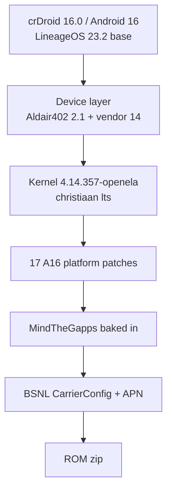

# Architecture

## The port in one picture

## Why the Android 13 device layer is the right base

The stable crDroid 9 (Android 13) ROM was built from the `moto-common`
branch-13 trees. The Android 16 community trees are almost the same hardware
description:

| Comparison | Result |
|---|---|
| `amogus_doha` `13` vs `2.1` | `BoardConfig.mk` identical; only `device.mk` gains NFC/fingerprint props and a stock fingerprint |
| vendor `13` vs `14` | only NFC firmware/config files and the vendor makefile change |
| kernel | same doha DTS/touch/audio/camera; the 4.14 tree is lifted to 4.14.357 |
| partitions | A/B, non-dynamic; system erofs 3.2 GB; vendor 620 MB; recovery in boot |

Therefore “port from Android 13” does **not** mean putting A13 framework code
on an A16 base. It means keeping the A13 hardware configuration and fixing the
platform assumptions that changed between API 33 and API 36.

## Partition facts

| Partition | Value |
|---|---|
| A/B slots | yes (`AB_OTA_UPDATER := true`, `slotselect` in fstab) |
| dynamic partitions / super | no (`TARGET_USES_DYNAMIC_PARTITIONS := false`) |
| system | 3,238,002,688 bytes, `erofs`, read-only |
| vendor | 620,756,992 bytes, `erofs`, read-only |
| boot | 67,108,864 bytes, contains recovery (`BOARD_USES_RECOVERY_AS_BOOT`) |
| product | no separate partition; product modules land in `system/product` |

Consequences:

- Add-on GApps zips cannot write `/system`; GApps must be baked in.
- Sideload installs to the inactive slot and then switches.
- Flashing `boot.img` is enough to change recovery.

## What the patches do

The Android 16 platform assumes a 5.10+ kernel and newer Qualcomm trees. The
patches are grouped by failure:

1. **Build**: kernel-header copy bug, VINTF kernel requirement, `libqsap_sdk`
   denylist, power HAL aconfig, C23 audio signatures, sepolicy duplicates,
   Wi-Fi services, QCC GPS protobuf.
2. **Boot**: 4.14 BPF gates, thermal HAL SELinux label, QCC GPS removal.
3. **Hardware**: touch module loading, WPA3-SAE, NFC retry, fingerprint
   fallback, thermal sensor names, camera CCI.
4. **Tethering**: `close_range()` in the kernel.
5. **Play Integrity**: locked/verified-boot properties in `system/core`.

See [PATCHES.md](PATCHES.md) for the file-by-file map.

## Build flow

`scripts/build.sh` is the only entry point. Each step is idempotent:

| Step | Action |
|---|---|
| `deps` | check host packages, install the `repo` launcher |
| `init` | `repo init` crDroid `16.0` |
| `manifest` | generate `.repo/local_manifests/doha.xml` from the pinned lists |
| `sync` | `repo sync` with retries |
| `patch` | apply the A16 patches, CarrierConfig, GApps keyboard fix, APN fix |
| `build` | `lunch lineage_amogus_doha-<release>-userdebug` + `make bacon` |
| `verify` | inspect the unpacked images |
| `collect` | copy zip/images/checksums to `dist/` |

The local manifest removes any base project that occupies one of our paths, so
the pinned revisions always win. All port-critical repositories are pinned to
exact commits in `config/pins.env`.

## Reproducibility

- Device, vendor, targets, kernel, all 28 supporting repos and every project
  the patch set touches are pinned to exact commits
  (`config/pins.env`, `manifest/*.list`).
- MindTheGapps is pinned to the `baklava` head recorded in `pins.env`.
- AOSP `CarrierConfig` is pinned to tag `android-16.0.0_r4`.
- The crDroid `16.0` base branch itself is not pinned: it contains 900+
  projects and is expected to move. After `sync`, the exact resolved SHAs are
  written to `work/state/resolved-manifest.xml`. `./scripts/build.sh snapshot`
  writes a committable copy under `manifests/`.
- Patch files are versioned in this repo.

This gives a deliberate split: the hardware/port layer is immutable, while
the ROM base can receive security updates. If a base update breaks a patch,
`patch` stops before compiling with the exact failing project and log.
