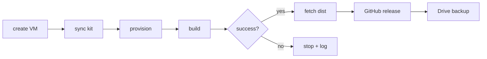

# One-command GCP build, release, backup and restore

Everything lives in **`gcp/doha.sh`**. No other GCP scripts.

## What it does



- **VM:** 16 vCPU / 64 GB, fastest shape first (`c2d-standard-16`, then
  `c2d-standard-8`, `t2d-standard-16`, `n2`, `n2d`, `e2`), cheapest
  approximate region order. The `e2` family is the slowest per core and was
  the reason the first full build took 10+ hours.
- **OS:** Ubuntu 24.04 LTS (`ubuntu-2404-lts-amd64`).
- **Disk:** 700 GB `pd-standard` + 32 GB swap. AOSP 16 needs ~250 GB checkout
  plus ~150 GB `out/`; the extra room covers ccache and snapshots.
- **Build:** runs `scripts/build.sh all` inside `tmux`, so SSH drops do not
  kill it.
- **Release:** only after a successful build, via `gh release create`.
- **Backup:** runs automatically after a successful `build` or `all`;
  incremental mirror at `gdrive:doha-a16/current/` with
  `work/android`, `work/ccache`, `dist` and the kit. First run uploads
  everything; later runs upload only new/changed files and replace the old
  file in place. No duplicate snapshot or history directory is kept. An
  explicit `--snapshot NAME` still creates a full snapshot.
- **Restore:** `current` by default, or a named snapshot, to a new VM or
  `--local`.

## Pick a mode

| Goal | Command | gcloud | gh | rclone |
|---|---|:---:|:---:|:---:|
| Build on the VM only | `./gcp/doha.sh build --no-backup` | yes | no | no |
| Build + Drive backup | `./gcp/doha.sh build` | yes | no | yes |
| Build + public release | `./gcp/doha.sh all --no-backup` | yes | yes | no |
| Full pipeline | `./gcp/doha.sh all --repo OWNER/REPO` | yes | yes | yes |
| No GitHub, but backup | `./gcp/doha.sh all --no-release` | yes | no | yes |
| No GitHub and no rclone | `./gcp/doha.sh all --no-release --no-backup` | yes | no | no |
| Local only | `../scripts/build.sh all` | no | no | no |

> [!WARNING]
> `all` checks rclone **before** starting the build. With no `gdrive:` remote,
> it stops immediately unless you pass `--no-backup`.
>
> If `gh` or the GitHub repo is unavailable, the build still finishes; the
> release step fails, backup still runs, and the command exits non-zero.
>
> `--local` does not mean “skip backup”. It means run backup/restore on this
> machine instead of the VM.

## Prerequisites

- `gcloud` installed and authenticated.
- `gh` installed and `gh auth login` done (for release).
- `rclone` configured **on the VM** with a remote named `gdrive`, or pass
  `--copy-rclone` to upload your local
  `~/.config/rclone/rclone.conf`.
- The buildkit repo pushed to GitHub if you want the release step to use it;
  `--repo OWNER/REPO` defaults to
  `ishwar-chandra/amogus_doha_custom_rom`.

## Commands

```bash
# Full pipeline: create -> build -> release -> backup
./gcp/doha.sh all

# Create the VM only
./gcp/doha.sh up

# Build, fetch dist/, then back up automatically on success
./gcp/doha.sh build

# Publish the last fetched dist-gcp/
./gcp/doha.sh release

# Backup the VM now
./gcp/doha.sh backup

# Restore latest snapshot to a VM (creates the VM if needed)
./gcp/doha.sh restore

# Restore into this machine
./gcp/doha.sh restore --local

# Configure Drive from an `rclone authorize "drive"` token
./gcp/doha.sh rclone-setup

# List snapshots
./gcp/doha.sh snapshots

# SSH / status / stop / start / delete
./gcp/doha.sh ssh
./gcp/doha.sh status
./gcp/doha.sh stop
./gcp/doha.sh start
./gcp/doha.sh down
```

## Important flags

```bash
./gcp/doha.sh all \
  --repo ishwar-chandra/amogus_doha_custom_rom \
  --remote gdrive \
  --dir doha-a16 \
  --copy-rclone
```

| Flag | Meaning |
|---|---|
| `--project ID` | GCP project |
| `--zone ZONE` | force a zone |
| `--machine-type TYPE` | force a shape |
| `--disk-size 700GB` | boot disk (default 700 GB) |
| `--spot` | cheaper, can be preempted |
| `--repo OWNER/REPO` | GitHub release target |
| `--tag TAG` | override the auto-detected release tag |
| `--remote NAME` | rclone remote (`gdrive`) |
| `--dir NAME` | Drive folder (`doha-a16`) |
| `--snapshot NAME` | backup/restore snapshot |
| `--copy-rclone` | upload local rclone config to the VM |
| `--no-release` | skip GitHub release; build and backup continue |
| `--no-backup` | skip Drive backup; build and release continue |
| `--local` | run backup/restore on this machine, not the VM |

## Rclone setup (token only)

On a machine with a browser, run:

```bash
rclone authorize "drive"
```

Log in to the Google account that owns the Drive, then copy the JSON token it
prints. On the machine running this kit:

```bash
./gcp/doha.sh rclone-setup
```

Paste the token when prompted. That command:

1. writes `/usr/bin/rclone`-compatible config on the VM
2. creates the `gdrive` remote with `scope=drive`
3. verifies with `rclone listremotes` and `rclone lsf gdrive:`

Non-interactive:

```bash
RCLONE_TOKEN='{"access_token":"...","token_type":"Bearer","refresh_token":"...","expiry":"..."}' \
  ./gcp/doha.sh rclone-setup
```

`--local` configures this machine instead of the VM.

`all` checks the remote **before** starting the multi-hour build. If it is
missing, it stops immediately with instructions instead of failing after the
build.

When run on the GCP VM itself, `build`, `backup`, `restore` and
`rclone-setup` automatically use the local machine. They do not query GCP or
try to create a second VM.

## GitHub release

The release tag is auto-detected from `BUILD_INFO.txt` (or the ROM zip's mtime), so an older artifact does not get stamped with today's date. Override with `--tag` only when needed.

`release` uses the local `dist-gcp/` directory:

- ROM zip
- `boot.img`, `dtbo.img`, `vbmeta.img`
- `SHA256SUMS`, `BUILD_INFO.txt`

If the tag exists, assets are uploaded with `--clobber`. A missing/unauthenticated
`gh` fails the release step but does not delete the build; the Drive backup
still runs.

## Costs and cleanup

- `e2-standard-12` is roughly $0.45–0.55/hour.
- 700 GB `pd-standard` is roughly $0.04/hour (about $28/month if left running).
- A 3–5 hour build is a few dollars of trial credit.
- Delete the VM when done:
  ```bash
  ./gcp/doha.sh down
  ```
  A stopped VM still bills for the disk.

If `create` fails with `QUOTA_EXCEEDED`, pick a zone with 12 vCPU quota:

```bash
./gcp/doha.sh up --zone us-central1-a --machine-type e2-standard-12
```

If the machine-type query is slow, skip it with `--zone` + `--machine-type`.
